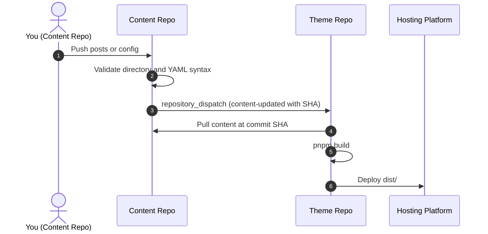

When posts are pushed to the content repo, a GitHub Actions workflow dispatches an event to the theme repo. The theme repo checks out content at that specific commit SHA, builds the site, and deploys it. This enables reproducible builds tied to specific commits.



Both repositories provide workflow templates:

- Content repo template: `.github/workflows/trigger-build.yml.example`
- Theme repo template: `.github/workflows/deploy.yml.example`

## Required Access Tokens

| Secret | Repository | Required Permissions |
| --- | --- | --- |
| `DISPATCH_TOKEN` | **Content Repo** | `Contents: Read and write` on the theme repo |
| `CONTENT_REPO_TOKEN` | **Theme Repo** | `Contents: Read` on the content repo (optional if public) |

See [Access Tokens](/en/guide/content-separation/pat/) for generation instructions.

## Step 1: enable the content repo workflow

In your content repo root, copy the template file:

```bash
cp .github/workflows/trigger-build.yml.example .github/workflows/trigger-build.yml
```

Update repository paths in the workflow:

```yaml title=".github/workflows/trigger-build.yml (parts to edit)"
jobs:
  validate:
    uses: YOUR_NAME/Shirone/.github/workflows/content-validate.yml@main
    with:
      theme_repository: YOUR_NAME/Shirone

  dispatch:
    needs: validate
    runs-on: ubuntu-latest
    steps:
      - uses: peter-evans/repository-dispatch@v4
        with:
          token: ${{ secrets.DISPATCH_TOKEN }}
          repository: YOUR_NAME/Shirone
          event-type: content-updated
          client-payload: '{"sha": "${{ github.sha }}"}'
```

Key points:

- `event-type` must remain `content-updated`;
- `client-payload` must include `sha` to avoid building outdated commits;
- `validate` calls the theme validation workflow and halts if syntax errors exist.

This workflow triggers only on modifications inside `content/`, `config/`, `data/`, `assets/`, `public/`, or `shirone.content.json`.

## Step 2: configure repository secrets

**Content Repo**: Navigate to Settings -> Secrets and variables -> Actions, and add `DISPATCH_TOKEN`.

**Theme Repo**: On the same page, add `CONTENT_REPO_TOKEN` with read permissions on the content repo.


## Step 3: enable the theme workflow

In your theme repo root, copy the template file:

```bash
cp .github/workflows/deploy.yml.example .github/workflows/deploy.yml
```

Update `CONTENT_REPOSITORY` with your content repository path:

```yaml title=".github/workflows/deploy.yml (parts to edit)"
env:
  CONTENT_REPOSITORY: YOUR_NAME/my-blog-content
  CONTENT_WORKING_COPY: .content-src
```

Scroll to the bottom of the file. The template provides ready-to-use snippets for four deployment targets (commented out by default). Choose the one matching your deployment goal, **uncomment it by removing `#`, and keep the other options commented out**.

### Option A: Deploy to Vercel (Upload Pre-Built Files)

Use this when your site is hosted on Vercel, but you prefer GitHub Actions to compile the pages.

```yaml title=".github/workflows/deploy.yml (Option A)"
      - name: Deploy to Vercel
        run: |
          pnpm dlx vercel@latest deploy dist --prod --yes \
            --token "$VERCEL_TOKEN"
        env:
          VERCEL_TOKEN: ${{ secrets.VERCEL_TOKEN }}
          VERCEL_ORG_ID: ${{ secrets.VERCEL_ORG_ID }}
          VERCEL_PROJECT_ID: ${{ secrets.VERCEL_PROJECT_ID }}
```

- **Required Secrets**: Add `VERCEL_TOKEN`, `VERCEL_ORG_ID`, and `VERCEL_PROJECT_ID` under Theme Repo Actions settings;
- **Platform settings**: In the Vercel dashboard, clear the Build Command and disable automated git builds so Vercel does not build twice;
- **Reference**: [Vercel Deployment Guide](/en/guide/deploy/vercel/).

### Option B: Deploy to GitHub Pages (Free Static Hosting)

Use this when hosting static pages directly on GitHub Pages.

Update permissions at the top of `deploy.yml` to include `pages: write` and `id-token: write`:

```yaml title=".github/workflows/deploy.yml (top permissions update)"
permissions:
  contents: read
  pages: write
  id-token: write
```

Then enable the Pages deployment snippet at the end of the file:

```yaml title=".github/workflows/deploy.yml (Option B)"
      - name: Upload Pages artifact
        uses: actions/upload-pages-artifact@v3
        with:
          path: dist
      - name: Deploy to Pages
        id: deployment
        uses: actions/deploy-pages@v4
```

- **Platform settings**: Under Theme Repo Settings -> Pages, set Source to `GitHub Actions`;
- **Reference**: [GitHub Pages Guide](/en/guide/deploy/github/).

### Option C: Deploy to Own Server / VPS (rsync Sync)

Use this when you own a cloud host or VPS and serve pages via Nginx.

```yaml title=".github/workflows/deploy.yml (Option C)"
      - name: Deploy to server
        env:
          DEPLOY_HOST: ${{ secrets.DEPLOY_HOST }}
          DEPLOY_USER: ${{ secrets.DEPLOY_USER }}
          DEPLOY_SSH_KEY: ${{ secrets.DEPLOY_SSH_KEY }}
          DEPLOY_DIR: /var/www/shirone
        run: |
          set -euo pipefail
          mkdir -p ~/.ssh && chmod 700 ~/.ssh
          printf '%s\n' "$DEPLOY_SSH_KEY" > ~/.ssh/deploy_key
          chmod 600 ~/.ssh/deploy_key
          ssh-keyscan -H "$DEPLOY_HOST" >> ~/.ssh/known_hosts
          rsync -az --delete -e "ssh -i ~/.ssh/deploy_key" \
            dist/ "$DEPLOY_USER@$DEPLOY_HOST:$DEPLOY_DIR/dist/"
```

- **Required Secrets**: Add `DEPLOY_HOST` (server IP), `DEPLOY_USER` (username), `DEPLOY_SSH_KEY` (private key), and `DEPLOY_DIR` (web root);
- **Behavior**: Connects to your server over SSH, uploads only changed files, and removes outdated files automatically;
- **Reference**: [Server Deployment Guide](/en/guide/deploy/server/).

### Option D: Trigger Platform Rebuild (Deploy Hook)

Use this when hosting on platforms like Netlify or EdgeOne that compile sites using their own runners.

In this setup, Actions sends an HTTP notification to the platform's webhook URL, and the platform pulls the repo and builds the site on its own:

```yaml title=".github/workflows/deploy.yml (Option D)"
      - name: Trigger platform build
        env:
          DEPLOY_HOOK: ${{ secrets.DEPLOY_HOOK }}
        run: |
          set -euo pipefail
          curl --fail-with-body --silent --show-error --retry 3 --retry-delay 2 \
            --max-time 30 --request POST "$DEPLOY_HOOK"
```

- **Required Secrets**: Add `DEPLOY_HOOK` (platform webhook URL);
- **Platform settings**: Keep the build command as `pnpm build` in the platform dashboard and configure `CONTENT_REPO_URL` to fetch content;
- **Reference**: [Deployment Hooks Guide](/en/guide/content-separation/deploy-hooks/).

::: warning Note
Options A, B, and C upload ready-to-serve `dist/` files; disable platform native builds in their dashboards. Option D requires keeping the platform build command. Do not enable both approaches simultaneously.
:::

## Step 4: verify

1. Edit any post in the content repo, commit, and push:

   ```bash
   git add .
   git commit -m "docs: test automated build"
   git push origin main
   ```

2. Open **Actions** in the content repo and verify that `validate` and `dispatch` succeed.
3. Open **Actions** in the theme repo and confirm the `content-updated` run succeeds.
4. Refresh the blog site to verify that updates appear correctly.

If any step fails, check the Actions log in that repository first. Token permission issues usually surface during dispatch or checkout steps. See [Troubleshooting](/en/guide/content-separation/faq/).

## Next steps

- [Automated Build and Deployment Workflows](/en/guide/development/workflows/): Complete workflow source code and execution logic
- [Server Deployment](/en/guide/deploy/server/): Build with GitHub Actions and sync via rsync
- [Deployment Overview](/en/guide/deploy/overview/): Pick a hosting platform and bring the site online
- [Deployment Hooks](/en/guide/content-separation/deploy-hooks/): Let the hosting platform pull and build on its own
