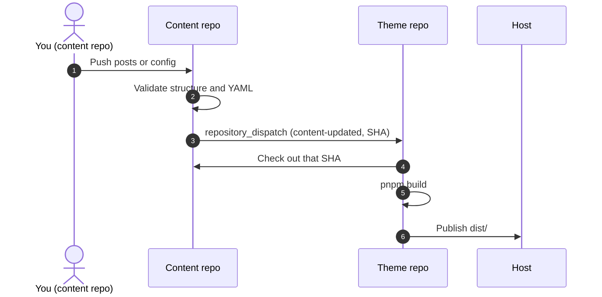

After pushing updates to the content repo, GitHub Actions in that repository dispatches an event to the theme repo. The theme repo checks out the content at that specific commit SHA, builds, and deploys. This pipeline builds exact commits reproducibly and is ideal for active content writing with strict build environments.



Both repositories provide workflow templates. Copy and rename them directly without writing simplified versions:

- Content repo: `.github/workflows/trigger-build.yml.example`
- Theme repo: `.github/workflows/deploy.yml.example`

## Tokens

| Secret | Stored in | Required permission |
| --- | --- | --- |
| `DISPATCH_TOKEN` | **Content repo** | Theme repo `Contents: Read and write` |
| `CONTENT_REPO_TOKEN` | **Theme repo** | Content repo `Contents: Read` (omit if content repo is public) |

See [Access Tokens](/en/guide/content-separation/pat/) for detailed token creation instructions.

## Step 1: enable the content workflow

In the content repo root, copy the example into an active workflow:

```bash
cp .github/workflows/trigger-build.yml.example .github/workflows/trigger-build.yml
```

Then edit the two repository placeholders:

```yaml title=".github/workflows/trigger-build.yml (parts to edit)"
jobs:
  validate:
    uses: YOUR_NAME/Shirone/.github/workflows/content-validate.yml@main
    with:
      theme_repository: YOUR_NAME/Shirone

  dispatch:
    needs: validate
    runs-on: ubuntu-latest
    steps:
      - uses: peter-evans/repository-dispatch@v4
        with:
          token: ${{ secrets.DISPATCH_TOKEN }}
          repository: YOUR_NAME/Shirone
          event-type: content-updated
          client-payload: '{"sha": "${{ github.sha }}"}'
```

Key requirements:

- `event-type` must remain exactly `content-updated`.
- `client-payload` must carry `sha`; without it, rapid pushes might build stale commits.
- The `validate` job calls the theme repo's validation workflow before dispatching, preventing broken content from triggering builds.

The workflow monitors `content/`, `config/`, `data/`, `assets/`, `public/`, and `shirone.content.json`. Editing only the content repo README will not trigger builds.

## Step 2: configure repository secrets

**Content repo**: navigate to Settings -> Secrets and variables -> Actions, create `DISPATCH_TOKEN`.

**Theme repo**: on the same settings page, create `CONTENT_REPO_TOKEN` with a token holding read access to the content repo.


## Step 3: enable the theme workflow

In the theme repo root:

```bash
cp .github/workflows/deploy.yml.example .github/workflows/deploy.yml
```

Update `CONTENT_REPOSITORY` with your content repository path:

```yaml title=".github/workflows/deploy.yml (parts to edit)"
env:
  CONTENT_REPOSITORY: YOUR_NAME/my-blog-content
  CONTENT_WORKING_COPY: .content-src
```

Next, configure the deployment step at the end of the file. The template provides four variants; uncomment one and keep the others commented:

| Variant | Use case |
| --- | --- |
| Variant A | Direct deployment via `vercel deploy dist --prod` |
| Variant B | Publish to GitHub Pages |
| Variant C | Sync to your own server using rsync |
| Variant D | Invoke a platform Deploy Hook for host-side builds |

When using Variants A, B, or C, the host functions strictly as static storage; disable the host's native build feature in its settings dashboard.

When using Variant D, the platform maintains `pnpm build` and requires `CONTENT_REPO_URL`.

Do not activate both methods simultaneously, as a single push will trigger duplicate deployments. Detailed settings are covered in [Deployment Overview](/en/guide/deploy/overview/) and [Deployment Hooks](/en/guide/content-separation/deploy-hooks/).

## Step 4: verify

1. Edit any post in the content repo, commit, and push:

   ```bash
   git add .
   git commit -m "docs: test automated build"
   git push origin main
   ```

2. Open **Actions** in the content repo and verify that `validate` and `dispatch` are green.
3. Open **Actions** in the theme repo and confirm the `content-updated` run succeeds.
4. Refresh the blog site to verify that updates appear correctly.

If any step fails, check the Actions log in that repository first. Token permission issues usually surface during dispatch or checkout steps. See [Troubleshooting](/en/guide/content-separation/faq/).

## Next steps

- [CI/CD Workflows](/en/guide/development/workflows/): In-depth look at workflow architecture and validation guards
- [Deploy to a Server](/en/guide/deploy/server/): Build with GitHub Actions and sync via rsync

[Deployment Overview](/en/guide/deploy/overview/): pick a hosting platform and bring the site online.

If you prefer not to maintain GitHub Actions, [Deployment Hooks](/en/guide/content-separation/deploy-hooks/) let the hosting platform pull and build on its own.
