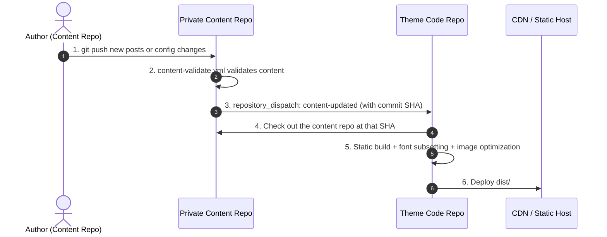

This is the recommended automation flow. A push to the content repo validates the content first, then sends `repository_dispatch` to the theme repo, which checks out that revision, builds, and deploys.

Do not hand-write a simplified workflow. Both repos already ship complete templates:

- Content repo: `.github/workflows/trigger-build.yml.example`
- Theme repo: `.github/workflows/deploy.yml.example`



---

## Core Configuration Steps

::: steps
1. **Create a dispatch PAT (stored in the content repo)**

   The content repo needs to send `repository_dispatch` to the theme repo:

   - GitHub -> avatar -> **Settings** -> **Developer settings**;
   - **Personal access tokens** -> **Fine-grained tokens**;
   - **Repository access**: **Only select repositories**, choose the ==theme repository==;
   - **Repository permissions** -> **Contents**: ==Read and write=={.error};
   - Generate and save the token immediately.

   > [!CAUTION] Keep the token secure
   > It is shown once. ==Never commit it=={.error}; store it only in GitHub encrypted secrets.

2. **Add `DISPATCH_TOKEN` to the content repo**

   In the ==private content repo== -> **Settings** -> **Secrets and variables** -> **Actions** -> **New repository secret**:

   - **Name**: `DISPATCH_TOKEN`
   - **Secret**: the PAT from step 1

   If the theme repo is private too, the validation workflow also needs `THEME_REPO_TOKEN` (`Contents: Read` on the theme repo).

3. **Add `CONTENT_REPO_TOKEN` to the theme repo (required for a private content repo)**

   In the ==theme repo== -> **Settings** -> **Secrets and variables** -> **Actions**:

   - **Name**: `CONTENT_REPO_TOKEN`
   - **Secret**: a PAT with `Contents: Read` on the private content repo

   `deploy.yml.example` uses it to check out the content repo. `DISPATCH_TOKEN` and `CONTENT_REPO_TOKEN` point in opposite directions and belong in different repositories.

4. **Enable the content repo trigger**

   ```bash
   cp .github/workflows/trigger-build.yml.example .github/workflows/trigger-build.yml
   ```

   Replace `LyraVoid/Shirone` / `YOUR_THEME_REPO` with your theme repo:

   ```yaml title=".github/workflows/trigger-build.yml (relevant sections)"
   on:
     push:
       branches: [main]
       paths:
         - "content/**"
         - "config/**"
         - "data/**"
         - "assets/**"
         - "public/**"
         - "shirone.content.json"
     workflow_dispatch: {}

   concurrency:
     group: trigger-build
     cancel-in-progress: true

   jobs:
     validate:
       uses: YOUR_NAME/YOUR_THEME_REPO/.github/workflows/content-validate.yml@main
       with:
         theme_repository: YOUR_NAME/YOUR_THEME_REPO
         theme_ref: main

     dispatch:
       needs: validate
       runs-on: ubuntu-latest
       steps:
         - uses: peter-evans/repository-dispatch@v4
           with:
             token: ${{ secrets.DISPATCH_TOKEN }}
             repository: YOUR_NAME/YOUR_THEME_REPO
             event-type: content-updated
             client-payload: '{"sha": "${{ github.sha }}"}'
   ```

   Key points:

   - The event type must be `content-updated` (past tense), not `content-update`.
   - Include `sha` in `client-payload`; otherwise rapid pushes can make the theme repo pull a stale content HEAD.
   - `validate` calls `content-validate.yml`, so content errors fail before a full build is wasted.
   - `concurrency` keeps only the newest dispatch.

5. **Enable the theme repo deployment workflow**

   Copy the theme repo's `deploy.yml.example` to `.github/workflows/deploy.yml`, then choose a deployment variant from the comments (Vercel, GitHub Pages, server rsync, or platform deploy hook). The shared part already includes:

   ```yaml title=".github/workflows/deploy.yml (relevant sections)"
   on:
     push:
       branches: [main]
     repository_dispatch:
       types: [content-updated]
     workflow_dispatch:
     schedule:
       - cron: "17 4 * * *"

   concurrency:
     group: deploy
     cancel-in-progress: true

   env:
     CONTENT_REPOSITORY: YOUR_NAME/YOUR_CONTENT_REPO
     CONTENT_WORKING_COPY: .content-src
   ```

   The build sequence is: checkout theme repo -> checkout content repo into `.content-src` with `CONTENT_REPO_TOKEN` -> `pnpm install --frozen-lockfile` -> `pnpm content:sync` -> `pnpm anime:sync --if-stale` -> `pnpm build`.

   The template resolves the content ref from `github.event.client_payload.sha`, then the `content_ref` workflow input, then falls back to `main`. Do not hard-code `main` here, or the dispatch SHA is lost.
:::

---

## Where dual-repo configuration lives

- Site config: preferably `config/site.yaml` in the content repo; it overrides `src/user/user-config.ts` at build time. Only single-repo setups edit `src/config/siteConfig.ts`.
- Content directories: `content/posts`, `content/moments`, `content/series`, `content/spec` map into the theme repo.
- Data and media: `data/`, `assets/`, `public/` are synchronized by `content:sync`.
- Docs: the content repo's `docs/` is not part of the build and does not match the trigger `paths` filter.

---

## Verification

::: steps
1. Create or edit a Markdown post in the content repo;
2. `git add .`, `git commit -m "docs: test dispatch"`, `git push`;
3. Open the content repo **Actions** tab and confirm both `validate` and `dispatch` succeed;
4. Open the theme repo **Actions** tab and confirm it received `content-updated` and deployed;
5. Verify the live post matches the pushed commit.
:::

---

## Next Steps

- Head to [Deploy Hook Integrations](/en/guide/content-separation/deploy-hooks/): Learn Cloudflare Pages, Vercel, EdgeOne, and Netlify integration patterns
