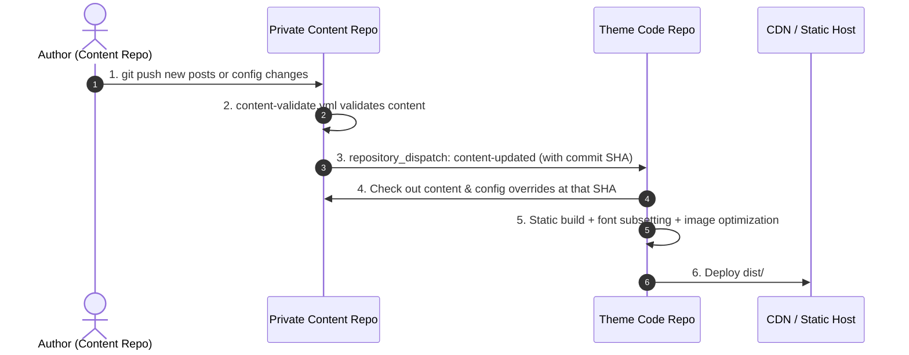

This is the officially recommended dual-repository automated deployment solution. Whenever posts or configurations are pushed to the content repository, syntax pre-validation is performed within the content repo first. A `repository_dispatch` event is then dispatched to the theme code repository; upon receiving this signal, the theme code repo automatically fetches the content and configuration at that specified commit, completes static compilation, font subsetting, and deploys to production.

Prefer using the ready-made templates provided officially instead of hand-writing simplified workflows. Both repositories ship with out-of-the-box examples:

- Content repository: `.github/workflows/trigger-build.yml.example`
- Theme code repository: `.github/workflows/deploy.yml.example`



---

## Step 1: Create a GitHub Personal Access Token (PAT)

After each push to the content repository, a `repository_dispatch` event must be sent to the theme code repository. Because this operation spans two separate repositories, we need to create a **Fine-grained Personal Access Token** on GitHub with read and write permissions targeting the theme repository.

::: steps
1. **Go to Personal Settings**

   Log in to GitHub, click your profile avatar in the upper right corner, and select **Settings** from the dropdown menu.

   

2. **Access Developer Settings**

   Scroll to the bottom of the left sidebar navigation and click **Developer Settings**.

   

   

3. **Navigate to Fine-grained Tokens**

   In the left sidebar, expand **Personal access tokens** and click **Fine-grained tokens**.

   

4. **Generate New Token**

   Click the **Generate new token** button in the upper right corner of the page.

   

5. **Configure Token Properties and Target Repository**

   Fill in the basic token information and restrict its permission scope:

   - **Token name**: Enter a recognizable name (e.g., `DISPATCH_TOKEN`);
   - **Expiration**: Choose an expiration period (90 days recommended, or custom);
   - **Repository access**: **Be sure to select Only select repositories**, and in the dropdown search box, **choose only your theme code repository**.

   

   > [!IMPORTANT] Why you must select the "Theme Code Repository"
   > The dispatch event notifies the theme code repository to trigger GitHub Actions; therefore, the token must have permissions over the **theme code repository**, not the content repository.

6. **Grant Contents Read and Write Permissions**

   Scroll down and expand the **Repository permissions** list under **Permissions**:
   - Locate the **Contents** permission entry;
   - Change the dropdown access from No access to **Read and write** (required to trigger cross-repository dispatch workflows).

   

7. **Generate and Securely Copy Token**

   Scroll to the bottom of the page and click the green **Generate token** button. Once generated, **immediately click the copy button to save the token string**.

   

   > [!CAUTION] The token is shown only once
   > GitHub will never display this token in plain text again after you navigate away. Save this string securely, and never commit it to any public repository or Markdown file.
:::

---

## Step 2: Configure Secret Credentials in Repositories

In a dual-repository architecture, two types of credentials are involved. They operate in opposite directions—refer to the table below to configure them in the correct repository:

| Credential Name | Target Repository | Required Permissions | Where to Configure | Purpose |
| :--- | :--- | :--- | :--- | :--- |
| `DISPATCH_TOKEN` | Theme code repo | `Contents: Read and write` | **Content repository** | Sends build trigger signal to theme repo after content updates (Required) |
| `CONTENT_REPO_TOKEN` | Private content repo | `Contents: Read` | **Theme code repository** | Allows theme repo Actions to pull private content and configuration (Only needed when content repo is private) |

### Configuration Method

Follow these steps to add a Secret in a GitHub repository:

::: steps
1. **Open Repository Settings**

   Open your target repository (e.g., your private content repository) and click **Settings** in the top navigation bar.

   

2. **Open Actions Secrets Menu**

   In the left sidebar, expand **Secrets and variables** and select **Actions**.

   

3. **Create Repository Secret**

   Click the green **New repository secret** button on the right side:
   - **Name**: Enter the secret name (e.g., `DISPATCH_TOKEN`, case-sensitive);
   - **Secret**: Paste the PAT string copied in Step 1;
   - Click the **Add secret** button at the bottom to save.

   
:::

> [!TIP] Additional credentials for private content repositories
> If your content repository is private, the theme code repository also requires permissions to check out posts. Follow the same steps above to generate a PAT with `Contents: Read` access to the content repository, and add it under **Theme code repository** Secrets named `CONTENT_REPO_TOKEN`.

---

## Step 3: Enable Content Repo Trigger Workflow

Copy the example workflow in the content repository to an active workflow file:

```bash
cp .github/workflows/trigger-build.yml.example .github/workflows/trigger-build.yml
```

Edit `.github/workflows/trigger-build.yml` and replace the repository placeholders with your actual theme code repository (e.g., `yourname/Shirone`):

```yaml title=".github/workflows/trigger-build.yml (core snippet)"
on:
  push:
    branches: [main]
    paths:
      - "content/**"
      - "config/**"
      - "data/**"
      - "assets/**"
      - "public/**"
      - "shirone.content.json"
  workflow_dispatch: {}

concurrency:
  group: trigger-build
  cancel-in-progress: true

jobs:
  validate:
    uses: yourname/Shirone/.github/workflows/content-validate.yml@main
    with:
      theme_repository: yourname/Shirone
      theme_ref: main

  dispatch:
    needs: validate
    runs-on: ubuntu-latest
    steps:
      - uses: peter-evans/repository-dispatch@v4
        with:
          token: ${{ secrets.DISPATCH_TOKEN }}
          repository: yourname/Shirone
          event-type: content-updated
          client-payload: '{"sha": "${{ github.sha }}"}'
```

**Key Configuration Notes**:
- **`event-type`**: Must be `content-updated` (past tense); do not misspell it as `content-update`.
- **`client-payload`**: Must include `sha: ${{ github.sha }}` to ensure the theme repo pulls the exact triggering commit under rapid pushes, avoiding stale caches.
- **`validate` job**: Invokes the theme repository's validation workflow before dispatching; if Markdown or YAML syntax errors exist, the pipeline stops with an error before wasteful building.
- **`concurrency`**: Automatically cancels outdated runs upon rapid successive pushes, keeping only the newest dispatch to conserve GitHub Actions minutes.

---

## Step 4: Enable Theme Repo Deployment Pipeline

In the theme code repository, copy `deploy.yml.example` to `.github/workflows/deploy.yml`, and uncomment the section corresponding to your deployment platform at the bottom:

```yaml title=".github/workflows/deploy.yml (core snippet)"
on:
  push:
    branches: [main]
  repository_dispatch:
    types: [content-updated]
  workflow_dispatch:
  schedule:
    - cron: "17 4 * * *"

concurrency:
  group: deploy
  cancel-in-progress: true

env:
  CONTENT_REPOSITORY: yourname/my-blog-content
  CONTENT_WORKING_COPY: .content-src
```

The build sequence automatically checks out the theme code repo, synchronizes the content repo into `.content-src` using `CONTENT_REPO_TOKEN`, and sequentially runs dependency installation, content synchronization, anime cache fetching, and static compilation.

::: warning Remember to align platform settings after choosing a deployment method
`deploy.yml.example` provides four deployment options at the end, each requiring different platform configurations. Inconsistent settings are a common cause of deployment failures:

- **Option A (Deploy to Vercel: Actions Direct Artifact Upload)**: Actions compiles the site and uploads pure static files in `dist/` directly to Vercel. Before using this option, you must configure the Vercel project as pure static hosting: change Framework Preset to `Other`, clear Build Command, and disconnect Git integration. Because uploaded `dist/` contains no `package.json`, any residual build command causes the cloud error `Error: Command "pnpm build" exited with 1`.

- **Option B / C (GitHub Pages / Server rsync)**: The platform only hosts static files, requiring no platform-side build configuration.

- **Option D (Platform Deploy Hook)**: The opposite of Option A. The platform **must retain** the build command `pnpm build`, with `CONTENT_REPO_URL` and `GIT_TERMINAL_PROMPT=0` configured in the platform console.

Note: Option A and Option D are mutually exclusive and must not be enabled simultaneously; otherwise, a single content push will trigger two builds at once.
:::

---

## Where Dual-Repo Configuration Lives

In dual-repository mode, theme code and article configuration are physically separated:

- **Site Configuration**: Primarily stored in `config/site.yaml` in the content repository, which automatically overrides theme defaults during build. Only single-repo setups edit `src/config/siteConfig.ts` directly.
- **Content Directories**: `content/posts`, `content/moments`, `content/series`, and `content/spec` automatically map to the theme code repository.
- **Data & Static Media**: `data/`, `assets/`, and `public/` are all aligned and synchronized automatically via `content:sync`.
- **Docs Directory**: The content repo's `docs/` is excluded from site builds, and modifying it will not trigger build workflows.

---

## Verifying the Automated Pipeline

::: steps
1. **Push a Test Post**

   Create or edit any Markdown post in the content repository, then commit and push:
   ```bash
   git add .
   git commit -m "docs: test cross-repo automation"
   git push origin main
   ```

2. **Check Content Repo Dispatch Status**

   Open the **Actions** tab in the content repository, and confirm that both `validate` and `dispatch` steps for `Trigger Theme Build` show green checkmarks.

3. **Check Theme Repo Build & Deployment**

   Open the **Actions** tab in the theme code repository, and confirm that the `content-updated` event was received and the full build and deployment completed successfully.

4. **Verify Online Site**

   Refresh your blog website to verify that the newly pushed article or configuration is rendered live.
:::

---

## Next Steps

- Proceed to [Deploy Hook Integrations](/en/guide/content-separation/deploy-hooks/): Learn integration solutions for Cloudflare Pages, Vercel, EdgeOne, and Netlify
