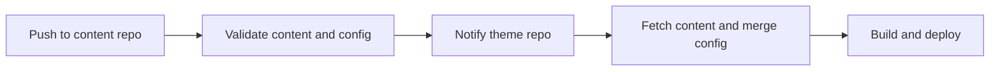

Content separation splits a blog into two Git repositories:

- **Theme repo**: Shirone source, styles, and build scripts. It can follow upstream updates and stay public.
- **Content repo**: your posts, moments, albums, data, and site configuration. It can be private.

Before building, the theme repo copies files from the content repo into its standard directories, then runs the normal build. The theme code itself does not need special handling for content separation.

## What goes where

| Content | Location |
| --- | --- |
| Posts, moments, series, about page copy | Content repo `content/` |
| Site title, navigation, sidebar, comments | Content repo `config/` |
| Projects, devices, skills, friends | Content repo `data/` |
| Images that should be optimized | Content repo `assets/` |
| Images, albums, anime covers served as-is | Content repo `public/` |
| Components, styles, build scripts | Theme repo `src/`, `scripts/` |

See [Creating a Content Repository](/en/guide/content-separation/init-repo/#content-repo-layout-and-mapping) for the full directory tree. Configuration syntax is covered in [Configuration Overlay](/en/guide/content-separation/config-overlay/).

## When two repositories are worth it

| Your situation | Recommendation |
| --- | --- |
| First blog, posts can be public | Single repo; least setup |
| Drafts, albums, or contact details should stay private | Dual repo with a private content repo |
| Long-term use and you plan to follow theme updates | Dual repo; updates will not conflict with your posts |
| Already wrote posts in a single repo | You can migrate at any time, see [Creating a Content Repository](/en/guide/content-separation/init-repo/) |

This is not a one-time decision. Running `pnpm content:eject` moves existing posts and configuration into a content repo and keeps local development working.

## What happens on a content update

With automated deployment enabled:

1. You change a post or YAML file in the content repo and push to `main`.
2. The content repo runs the theme repo's validation workflow, which checks directory structure and configuration fields.
3. If validation passes, it sends a `content-updated` event with the current commit SHA.
4. The theme repo checks out that SHA, runs `pnpm build`, and publishes `dist/` to your host.

If you prefer the host to build, trigger it with a Deploy Hook instead. See [Deployment Hooks](/en/guide/content-separation/deploy-hooks/) for the difference.

## Local writing

You do not need to push to see changes. Point `CONTENT_DIR` at the content repo, run `pnpm content:sync` to copy files into `src/content/` and the other targets, then run `pnpm dev`. `pnpm content:watch` repeats the sync whenever you save.

## Next steps

[Creating a Content Repository](/en/guide/content-separation/init-repo/): migrate with one command, or start from the template.
