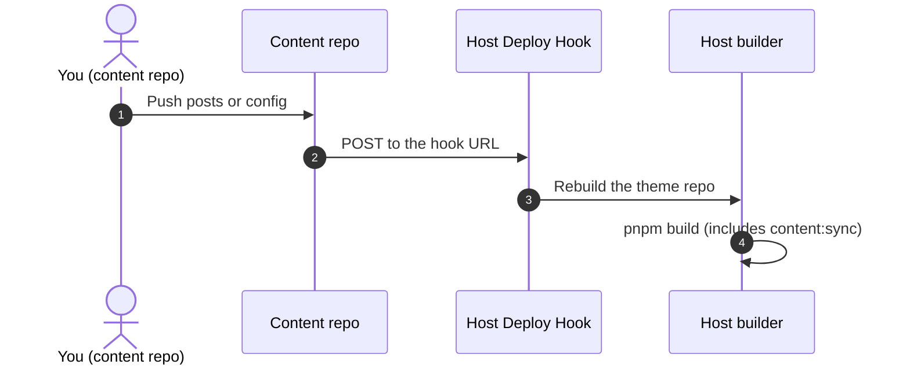

A deployment hook is an HTTP trigger URL provided by a hosting platform. After pushing changes to the content repo, sending a POST request to that URL triggers the platform to fetch the theme repo and build.



## Pick one: Actions or hooks

| Comparison | Actions dispatch | Deployment hook |
| --- | --- | --- |
| Builder | Theme repo GitHub Actions | Hosting platform builder |
| Host settings | Disable host build; receive static `dist/` | Keep `pnpm build` |
| Content source | `CONTENT_DIR` pointing to checked-out `.content-src/` | `CONTENT_REPO_URL` fetching remote repo |
| Build precision | Builds exact commit SHA that triggered run | Fetches latest HEAD of branch |

::: warning
Do not configure both workflows simultaneously, as each push triggers duplicate builds that overwrite one another. If the host keeps its build command while Actions uploads prebuilt `dist/` files, the host log fails with `Error: Command "pnpm build" exited with 1`.
:::

## Platform quick reference

The content repo's `trigger-build.yml.example` includes hook steps for all four supported platforms. Steps are automatically skipped when the corresponding secret is not configured, so you do not need separate workflows per host.

| Platform | Hook configuration location | Content repo secret | Details |
| --- | --- | --- | --- |
| Cloudflare Pages | Settings -> Builds & deployments -> Deploy hooks | `CLOUDFLARE_DEPLOY_HOOK` | [Cloudflare Pages](/en/guide/deploy/cloudflare/) |
| Vercel | Settings -> Git -> Deploy Hooks | `VERCEL_DEPLOY_HOOK` | [Vercel](/en/guide/deploy/vercel/) |
| EdgeOne Pages | Project settings -> Build and deployment -> Deploy trigger | `EDGEONE_DEPLOY_HOOK` | [EdgeOne Pages](/en/guide/deploy/edgeone/) |
| Netlify | Site configuration -> Build & deploy -> Build hooks | `NETLIFY_DEPLOY_HOOK` | [Netlify](/en/guide/deploy/netlify/) |

When creating hooks, set the target branch to `main`. Copy the generated URL and add it to the corresponding secret in your content repo.

## Required platform variables

When using deployment hooks, the dual-repo setup requires the following environment variables in the platform dashboard:

```text
CONTENT_REPO_URL=https://x-access-token:<TOKEN>@github.com/OWNER/REPO.git
CONTENT_REPO_REF=main
GIT_TERMINAL_PROMPT=0
```

`GIT_TERMINAL_PROMPT=0` prevents the build machine from halting on interactive credential prompts. Keep the build command as `pnpm build` and the output directory as `dist`; `pnpm build` already runs the content sync step, so do not add it a second time.

Configure Node.js versions per platform: Cloudflare, Vercel, and Netlify require Node 26. EdgeOne currently supports up to Node 24, which builds Shirone reliably.

## Build precision

A deployment hook triggers a rebuild on the hosting platform, but platforms usually fetch the latest HEAD commit of the branch. This might not correspond to the commit that initiated the hook. For rapid successive pushes or reproducible historical builds, use [Cross-Repo CI](/en/guide/content-separation/ci-dispatch/).

## Next steps

- [Automated Build and Deployment Workflows](/en/guide/development/workflows/): Learn how the content repository workflow triggers deploy hooks
- [Troubleshooting](/en/guide/content-separation/faq/): token permissions, authentication errors, and configuration debugging.
