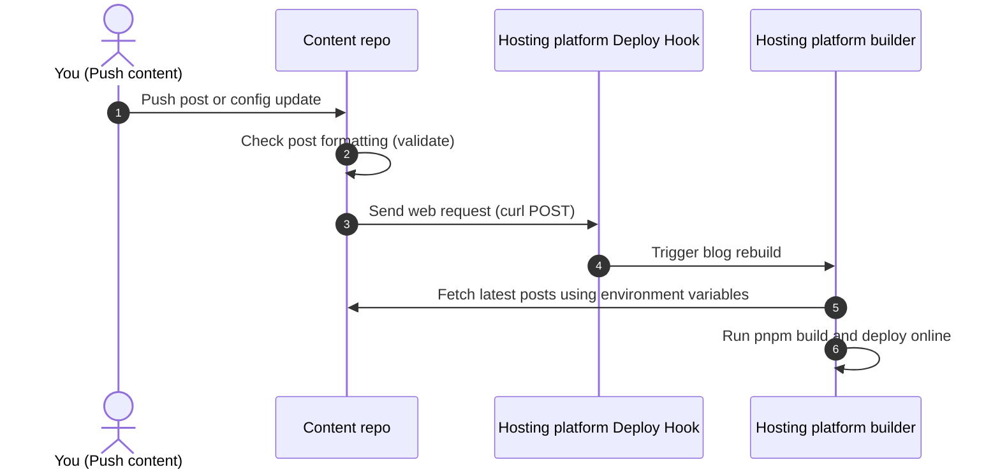

A deployment hook (Deploy Hook) is a dedicated URL provided by your hosting platform (such as Cloudflare Pages, Vercel, EdgeOne, or Netlify).

In a separated repository architecture, your blog theme code lives in a code repository, while your articles live in a content repository. When you finish writing an article and push it to your content repo, an automated script in that repo sends a quick notification to this URL. Once the hosting platform receives the notification, it automatically starts a build, pulls your theme code along with your latest articles, packages everything, and deploys the site.



## Pick one: Deploy Hooks or Actions Cross-Repo CI

In a separated repository setup, there are two primary automated paths to deploy your blog. You can choose the one that best fits your workflow:

| Comparison | Deploy Hooks (This guide) | Actions Cross-Repo CI |
| --- | --- | --- |
| Who runs the build | The hosting platform's build machine | GitHub Actions virtual machine |
| Content repo workflow | Validates format and notifies the hook URL | Validates format and notifies theme repo to run full pipeline |
| Host platform settings | Keep platform build enabled with `pnpm build` | Disable platform build, only receive prebuilt `dist/` |
| Content repo configuration | Add content repo Git URL to platform environment variables | Configure cross-repo access tokens in GitHub secrets |
| Best suited for | Users who prefer a simple setup using the platform's native build | Users who require exact commit SHA builds or deploy to personal servers |

::: warning Do not configure both simultaneously
Never configure both Actions cross-repo CI and deployment hooks for the same hosting platform.

Enabling both causes every content push to trigger two duplicate builds, potentially overwriting each other. If the platform keeps its own build command while Actions simultaneously uploads static files, the platform build logs will report conflicting build errors.
:::

## Setup Steps

The setup process consists of five steps:

::: steps

1. **Obtain the Deploy Hook URL from your hosting platform**

   Open your hosting platform console, create a deployment hook for your blog project, and copy the generated Webhook URL:

   :::: tabs
   @tab Cloudflare Pages
   Go to your project **Settings** -> **Builds & deployments**, and scroll down to the **Deploy hooks** section:

   - Click the **Add hook** button;
   - Set **Hook name** (for example, `content-update`);
   - Select your primary branch `main` under **Branch**;
   - Click **Add hook** to save, then copy the generated Webhook URL.

   

   

   @tab Vercel
   Go to your project **Settings** -> **Git** page, and scroll down to the **Deploy Hooks** section:

   - Set **Hook Name** (for example, `content-update`);
   - Enter your primary branch `main` under **Branch**;
   - Click **Create Hook**;
   - Copy the generated URL (similar to `https://api.vercel.com/v1/integrations/deploy/prj_...`).

   @tab EdgeOne Pages
   Go to your project **Project Settings** -> **Build and deployment**, and locate the **Deploy trigger** section:

   - Click **Add Trigger**;
   - Select branch `main`;
   - Save and copy the generated trigger URL.

   

   @tab Netlify
   Go to your project **Site configuration** -> **Build & deploy** -> **Continuous deployment**, and find the **Build hooks** section:

   - Click the **Add build hook** button;
   - Set **Title** (for example, `content-update`);
   - Select `main` under **Branch to build**;
   - Click **Save** and copy the generated Webhook URL.
   ::::

2. **Add content repository environment variables to your hosting platform**

   By default, the hosting platform's build machine only links to your theme code repository. When running the build command, it needs to know where your posts are stored, so you must provide the content repository environment variables in the platform dashboard.

   Go to the Environment Variables settings in your hosting platform dashboard and add the following variables:

   | Variable | Required | Description and Recommended Value |
   | --- | --- | --- |
   | `CONTENT_REPO_URL` | Yes | The Git URL of your content repository (see format below) |
   | `CONTENT_REPO_REF` | No | Content repo branch, usually `main` |
   | `GIT_TERMINAL_PROMPT` | Yes | Always set to `0` to prevent builds from halting on password prompts |

   Formatting rules for `CONTENT_REPO_URL`:

   - **Public content repository**: Use the standard HTTPS clone URL:
     ```text
     https://github.com/USERNAME/CONTENT_REPO.git
     ```
   - **Private content repository**: Include a Personal Access Token with read permissions:
     ```text
     https://x-access-token:<YOUR_TOKEN>@github.com/USERNAME/CONTENT_REPO.git
     ```
     For instructions on generating this token, see [Personal Access Tokens](/en/guide/content-separation/pat/), selecting `Contents: Read` permission.

   **Check platform Node.js versions and build settings**:

   - Cloudflare Pages, Vercel, and Netlify recommend Node.js 26; EdgeOne currently supports Node.js 24. Both versions build Shirone without issue;
   - Keep the build command as `pnpm build` and the output directory as `dist`. The `pnpm build` command automatically runs content synchronization, so no extra commands are needed.

3. **Save the hook URL in your content repository GitHub Secrets**

   Open your **content repository** (the repository where your markdown posts live) on GitHub, and save the hook URL as a GitHub Actions secret:

   1. Go to your content repo **Settings** -> **Secrets and variables** -> **Actions**;
   2. Click the **New repository secret** button;
   3. Enter the secret name (Name) corresponding to your platform, and paste the URL in the Secret field;
   4. Click **Add secret** to save.

   

   

   

   Use the exact secret name corresponding to your host:

   | Hosting Platform | Secret Name |
   | --- | --- |
   | Cloudflare Pages | `CLOUDFLARE_DEPLOY_HOOK` |
   | Vercel | `VERCEL_DEPLOY_HOOK` |
   | EdgeOne Pages | `EDGEONE_DEPLOY_HOOK` |
   | Netlify | `NETLIFY_DEPLOY_HOOK` |

4. **Enable the trigger workflow in your content repository**

   In your content repository root, rename the example workflow template to activate it:

   ```bash
   cp .github/workflows/trigger-build.yml.example .github/workflows/trigger-build.yml
   ```

   When content changes are detected, this workflow sends a web request to your configured deploy hook:

   ```yaml title=".github/workflows/trigger-build.yml (Deploy hook section)"
   jobs:
     # Step 1: Check formatting and syntax of articles and configuration
     validate:
       uses: LyraVoid/Shirone/.github/workflows/content-validate.yml@main
       with:
         theme_repository: LyraVoid/Shirone # Replace with your theme repository
         theme_ref: main

     # Step 2: After validation passes, trigger the hosting platform deploy hook
     dispatch:
       needs: validate
       runs-on: ubuntu-latest
       timeout-minutes: 5
       steps:
         # Trigger Cloudflare Pages (automatically skipped if secret is not set)
         - name: Trigger Cloudflare Pages deploy hook
           env:
             CLOUDFLARE_DEPLOY_HOOK: ${{ secrets.CLOUDFLARE_DEPLOY_HOOK }}
           if: ${{ env.CLOUDFLARE_DEPLOY_HOOK != '' }}
           run: |
             curl -s -S -X POST "${{ env.CLOUDFLARE_DEPLOY_HOOK }}"

         # Trigger Vercel (automatically skipped if secret is not set)
         - name: Trigger Vercel deploy hook
           env:
             VERCEL_DEPLOY_HOOK: ${{ secrets.VERCEL_DEPLOY_HOOK }}
           if: ${{ env.VERCEL_DEPLOY_HOOK != '' }}
           run: |
             curl -s -S -X POST "${{ env.VERCEL_DEPLOY_HOOK }}"

         # Trigger EdgeOne (automatically skipped if secret is not set)
         - name: Trigger EdgeOne deploy hook
           env:
             EDGEONE_DEPLOY_HOOK: ${{ secrets.EDGEONE_DEPLOY_HOOK }}
           if: ${{ env.EDGEONE_DEPLOY_HOOK != '' }}
           run: |
             curl -s -S -X POST "${{ env.EDGEONE_DEPLOY_HOOK }}"

         # Trigger Netlify (automatically skipped if secret is not set)
         - name: Trigger Netlify deploy hook
           env:
             NETLIFY_DEPLOY_HOOK: ${{ secrets.NETLIFY_DEPLOY_HOOK }}
           if: ${{ env.NETLIFY_DEPLOY_HOOK != '' }}
           run: |
             curl -s -S -X POST "${{ env.NETLIFY_DEPLOY_HOOK }}"
   ```

   The workflow includes conditional checks (`if`) for all four platforms. Platforms without configured secrets are skipped automatically, so you do not need to delete steps for unused platforms.

5. **Push an update and verify**

   With everything configured, run a quick verification test:

   1. Edit an article or add a new test post in your content repository;
   2. Run `git push` to push your commit to branch `main`;
   3. Check the **Actions** tab in your content repository to confirm that the `Trigger Theme Build` run completes with a green checkmark;
   4. Open your hosting platform dashboard under Deployments to confirm that a new build triggered automatically;
   5. Once the build finishes, refresh your live site to confirm the new post is visible.

:::

## Troubleshooting

::: collapse
- The content repo Actions run succeeds, but the hosting platform does not trigger a build?

  Check that the secret name in your content repository matches the exact spelling in the table above, paying close attention to uppercase letters. Also check that the full webhook URL was copied without missing trailing characters.

- The hosting platform build log reports a failure when cloning content or an authentication error?

  If your content repository is private, verify that `CONTENT_REPO_URL` configured in the platform dashboard contains a valid personal access token, and confirm that the token has not expired and has `Contents: Read` permission enabled.

- What happens if I push multiple times within a short period?

  The content repository workflow uses concurrency control (`concurrency`). When multiple pushes occur in quick succession, older unfinished runs are automatically cancelled so only the latest push triggers a build.

  A deploy hook instructs the hosting platform to rebuild using the latest commit on the branch. If your workflow requires every historical commit to be built strictly and reproducibly, consider using [Cross-Repo CI](/en/guide/content-separation/ci-dispatch/).
:::

## Next steps

- [Personal Access Tokens](/en/guide/content-separation/pat/): Learn how to create tokens with read permissions for private repositories
- [Cross-Repo CI](/en/guide/content-separation/ci-dispatch/): Learn about the alternative GitHub Actions deployment workflow
- [Automated Workflows](/en/guide/development/workflows/): Learn more about workflow parameters and behavior
- [Troubleshooting](/en/guide/content-separation/faq/): Common dual-repo issues and solutions
