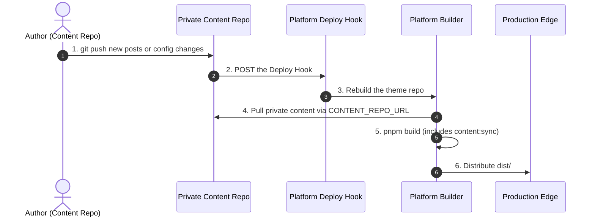

If you host the theme repo on Cloudflare Pages, Vercel, Tencent Cloud EdgeOne, or Netlify, you can use ==Deploy Hook Trigger Mode==.

A push to the content repo sends one HTTP POST to the platform's Deploy Hook. The platform then pulls the theme repo and rebuilds. Its build runs `pnpm build`, which already includes `content:sync`; **do not prepend `pnpm content:sync &&`** to the build command.



See [Content Sources and Environment Variables](/en/guide/content-separation/content-sources/) for `CONTENT_REPO_URL`, `CONTENT_REPO_REF`, and private repo token formats.

Deploy Hooks and [cross-repo GitHub Actions dispatch](/en/guide/content-separation/ci-dispatch/) are mutually exclusive. With only `DISPATCH_TOKEN`, the theme repo Actions builds. With only a `*_DEPLOY_HOOK` secret, the platform builds. Configuring both causes two deployments for one push.

::: tip Start from the official trigger template
You do not need a separate workflow per platform. The content repo's `.github/workflows/trigger-build.yml.example` already contains Cloudflare, Vercel, EdgeOne, and Netlify hook steps; each is skipped when its secret is absent.

After copying it to `trigger-build.yml`, replace two placeholders: `repository` must point to your theme repo, and the `validate` job's `theme_repository` must point to the same repo. Then add only the secrets you need.

If you want validation first, its `validate` job calls the theme repo's `content-validate.yml`.
:::

---

## 1. Cloudflare Pages Setup <Badge text="Recommended" type="tip" />

::: steps
1. **Create the Deploy Hook**

   - Cloudflare Dashboard -> **Workers & Pages** -> your project;
   - **Settings** -> **Builds & deployments** -> **Deploy hooks** -> **Add deploy hook**;
   - Name it `content-push`, select ==main==, create it, and copy the URL.

2. **Configure build and environment variables**

   Under **Settings** -> **Environment variables**, add:

   | Variable | Value |
   | --- | --- |
   | `NODE_VERSION` | `26` |
   | `PNPM_VERSION` | `11.28.2` |
   | `GIT_TERMINAL_PROMPT` | `0` |
   | `CONTENT_REPO_URL` | `https://x-access-token:<TOKEN>@github.com/<OWNER>/<CONTENT_REPO>.git` |

   Build command `pnpm build`, output `dist`. For dual-repo mode, also consider `CONTENT_REPO_REF=main`.

   > [!WARNING]
   > Create a **Pages** project, not a Worker. A Worker build fails with `__dirname is not defined`.

3. **Add the content repo secret**

   In the private content repo -> **Settings** -> **Secrets and variables** -> **Actions**:

   - **Name**: `CLOUDFLARE_DEPLOY_HOOK`
   - **Secret**: the URL from step 1

4. **Enable the trigger workflow**

   Use `trigger-build.yml.example`, or a dedicated workflow:

   ```yaml title=".github/workflows/trigger-cloudflare.yml"
   name: Trigger Cloudflare Pages Build

   on:
     push:
       branches: [main]
     workflow_dispatch:

   jobs:
     deploy-hook:
       runs-on: ubuntu-latest
       steps:
         - name: Call Cloudflare Deploy Hook
           env:
             CLOUDFLARE_DEPLOY_HOOK: ${{ secrets.CLOUDFLARE_DEPLOY_HOOK }}
           if: ${{ env.CLOUDFLARE_DEPLOY_HOOK != '' }}
           run: |
             curl --fail-with-body --silent --show-error \
               --retry 3 --retry-delay 2 --max-time 30 \
               --request POST "$CLOUDFLARE_DEPLOY_HOOK"
   ```
:::

---

## 2. Vercel Setup <Badge text="Popular" type="info" />

::: steps
1. **Create the Deploy Hook**

   - Vercel -> project -> **Settings** -> **Git** -> **Deploy Hooks**;
   - Name it `content-push`, branch `main`, create it, and copy the URL.

2. **Configure project and environment variables**

   Under **Settings** -> **General** -> **Node.js Version**, select `26.x`. Vercel does not read a `NODE_VERSION` environment variable.

   You can add environment variables on the import screen under **Environment Variables**, or later under **Deployments** -> **Environments**:

   | Variable | Value |
   | --- | --- |
   | `CONTENT_REPO_URL` | `https://x-access-token:<TOKEN>@github.com/<OWNER>/<CONTENT_REPO>.git` |
   | `CONTENT_REPO_REF` | `main` (optional) |
   | `GIT_TERMINAL_PROMPT` | `0` |

   Keep the build command `pnpm build` and output `dist`.

3. **Add the content repo secret**

   Add `VERCEL_DEPLOY_HOOK` with the URL from step 1.

4. **Enable the trigger workflow**

   Use the Vercel hook step in `trigger-build.yml.example`, or POST with:

   ```bash
   curl --fail-with-body --silent --show-error \
     --retry 3 --retry-delay 2 --max-time 30 \
     --request POST "$VERCEL_DEPLOY_HOOK"
   ```
:::

---

## 3. Tencent Cloud EdgeOne Setup <Badge text="APAC" type="tip" />

::: steps
1. **Create the deploy trigger**

   - EdgeOne Pages console -> project settings -> **Build & Deploy** -> **Deploy Hooks**;
   - Add a hook for `main` and copy the URL.

2. **Configure build and environment variables**

   | Setting | Value |
   | --- | --- |
   | Node.js version | `24` |
   | Build command | `npm i -g pnpm@11.28.2 && pnpm build` |
   | Output directory | `dist` |
   | `CONTENT_REPO_URL` | `https://x-access-token:<TOKEN>@github.com/<OWNER>/<CONTENT_REPO>.git` |
   | `CONTENT_REPO_REF` | `main` (optional) |
   | `GIT_TERMINAL_PROMPT` | `0` |

   EdgeOne currently offers Node.js 24 as its highest selectable version, and Shirone builds correctly on it. If the image lacks the matching pnpm, install it in the build command; EdgeOne has no documented `PNPM_VERSION` variable.

3. **Add the content repo secret**

   Add `EDGEONE_DEPLOY_HOOK` with the hook URL.

4. **Enable the trigger workflow**

   Use the EdgeOne hook step in `trigger-build.yml.example`.
:::

---

## 4. Netlify Setup

::: steps
1. **Create the Build Hook**

   - **Site configuration** -> **Build & deploy** -> **Continuous deployment**;
   - **Build hooks** -> **Add build hook**;
   - Choose `main`, save, and copy the URL.

2. **Configure build and environment variables**

   Under **Site configuration** -> **Environment variables**, add:

   | Variable | Value |
   | --- | --- |
   | `NODE_VERSION` | `26` |
   | `GIT_TERMINAL_PROMPT` | `0` |
   | `CONTENT_REPO_URL` | `https://x-access-token:<TOKEN>@github.com/<OWNER>/<CONTENT_REPO>.git` |

   Build command `pnpm build`, publish directory `dist`. Netlify selects pnpm from `package.json` `packageManager` or mise. If the log still shows a mismatched pnpm, prepend `npm i -g pnpm@11.28.2 &&` to the build command.

3. **Add the content repo secret**

   Add `NETLIFY_DEPLOY_HOOK` with the Build Hook URL.

4. **Enable the trigger workflow**

   Use the Netlify hook step in `trigger-build.yml.example`.
:::

---

## Version and trigger precision

- A Deploy Hook only asks the platform to rebuild. The platform usually builds the content branch HEAD, not necessarily the exact commit that triggered it. For exact SHA builds under rapid pushes, use [cross-repo Actions dispatch](/en/guide/content-separation/ci-dispatch/).
- Platform builders support different Node versions: Cloudflare / Vercel / Netlify use 26; EdgeOne uses 24. Do not write 26 for every platform.
- A private content repo requires `CONTENT_REPO_URL` and `GIT_TERMINAL_PROMPT=0`; otherwise the builder can hang on an interactive credential prompt.
- `pnpm build` already includes `content:sync`; keep the build command as `pnpm build`.

---

## Deploy Secret Reference Table

| Platform | GitHub Secret Name (Strict Match) | Trigger Type |
| :--- | :--- | :--- |
| **Cross-Repo CI (Recommended)** | `DISPATCH_TOKEN` <Badge text="Recommended" type="tip" /> | Dispatches GitHub Actions in the theme repo for the full build |
| **Cloudflare Pages** | `CLOUDFLARE_DEPLOY_HOOK` <Badge text="Edge" type="info" /> | POSTs to the Cloudflare Deploy Hook |
| **Vercel** | `VERCEL_DEPLOY_HOOK` <Badge text="Global" type="info" /> | POSTs to the Vercel Deploy Hook |
| **Tencent Cloud EdgeOne** | `EDGEONE_DEPLOY_HOOK` <Badge text="APAC" type="tip" /> | POSTs to the EdgeOne Deploy Hook |
| **Netlify** | `NETLIFY_DEPLOY_HOOK` <Badge text="General" type="info" /> | POSTs to the Netlify Build Hook |

---

## Next Steps

- Head to [Troubleshooting & FAQ](/en/guide/content-separation/faq/): View permission diagnosis, config overrides, and build error resolutions
