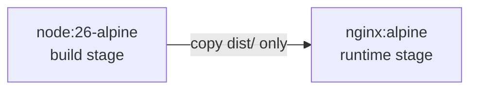

This guide covers containerized deployment using Docker. For decisions on build locations and managing platform build commands, see [Deployment Overview](/en/guide/deploy/overview/).

Docker encapsulates build and runtime environments within a portable image, ensuring consistency across servers without depending on the host's local Node.js setup.

## Image structure

Builds leverage multi-stage container builds:



- Build stage: uses Node 26 and pnpm to run the full `pnpm build` pipeline;
- Runtime stage: bundles only lightweight Nginx and static files, keeping image size below 50 MB with no Node runtime overhead.

## Three files

### .dockerignore

```text title=".dockerignore"
.git
node_modules
dist
.astro
.vscode
.github
docs
tests
public/assets/moments/thumbnails
```

Never exclude `scripts/`. `pnpm build` executes `scripts/content/sync.mjs` and font validation scripts during builds; missing this directory causes build failures.

### Dockerfile

```dockerfile title="Dockerfile"
# Build stage
FROM node:26-alpine AS builder

WORKDIR /app

# Node.js 26 no longer bundles corepack
RUN npm install -g pnpm@11.28.2

# Copy package manifests first to leverage layer caching
COPY package.json pnpm-lock.yaml .npmrc ./
RUN pnpm install --frozen-lockfile

# Copy remaining source files and execute build
COPY . .
RUN pnpm build

# Runtime stage
FROM nginx:alpine

COPY --from=builder /app/dist /usr/share/nginx/html
COPY nginx.conf /etc/nginx/conf.d/default.conf

EXPOSE 80

CMD ["nginx", "-g", "daemon off;"]
```

Separating dependency manifests from source code into two `COPY` operations ensures packages reinstall only when dependencies change. Day-to-day writing updates hit cached layers directly.

### nginx.conf

```nginx title="nginx.conf"
server {
    listen 80;
    server_name _;
    root /usr/share/nginx/html;
    index index.html;

    gzip on;
    gzip_types text/css application/javascript application/json image/svg+xml;
    gzip_min_length 1024;

    location /assets/ {
        expires 1y;
        add_header Cache-Control "public, immutable";
    }

    location /pagefind/ {
        expires 24h;
    }

    location / {
        try_files $uri $uri/ =404;
    }
}
```

> Font subsetting and Pagefind indexing cause memory usage to peak during builds. Allocate at least 4 GB of RAM to Docker.

## Dual-repo setup

When building within container images, pass content source parameters to `pnpm build`. Never store URLs containing access tokens in `ARG` or `ENV` instructions to avoid exposing credentials in image layers. Use Docker BuildKit secrets:

```dockerfile
# syntax=docker/dockerfile:1
RUN --mount=type=secret,id=content_repo_url \
    CONTENT_REPO_URL="$(cat /run/secrets/content_repo_url)" pnpm build
```

```bash
echo "https://x-access-token:<TOKEN>@github.com/<OWNER>/<CONTENT_REPO>.git" > .content-repo-url
docker build --secret id=content_repo_url,src=.content-repo-url -t shirone-blog .
rm .content-repo-url
```

Alternatively, prebuild `dist/` in CI and serve it using a bare Nginx image.

## Build and run

```bash
docker build -t shirone-blog .

docker run -d --name shirone-blog \
  -p 8080:80 \
  --restart unless-stopped \
  shirone-blog
```

Open `http://localhost:8080` to verify pages and search functionality.

### Docker Compose

```yaml title="docker-compose.yml"
services:
  shirone:
    build: .
    image: shirone-blog:latest
    container_name: shirone-blog
    ports:
      - "8080:80"
    restart: unless-stopped
```

```bash
docker compose up -d
docker compose up -d --build   # rebuild and restart after content updates
```

## Update and roll back

```bash
git pull
docker compose up -d --build
```

Previous image builds remain on local disk. For rollbacks, tag the previous image ID and update `image` in the Compose file:

```bash
docker images                      # find previous image ID
docker tag <OLD_IMAGE_ID> shirone-blog:rollback
docker compose up -d               # ensure image points to shirone-blog:rollback
```

## Reverse proxy and HTTPS

Production setups typically run Nginx or Caddy on the host machine to proxy container ports:

```nginx title="host /etc/nginx/conf.d/blog.conf"
server {
    listen 443 ssl;
    server_name your-domain.com;

    location / {
        proxy_pass http://127.0.0.1:8080;
        proxy_set_header Host $host;
        proxy_set_header X-Real-IP $remote_addr;
    }
}
```

SSL certificates can be managed automatically using certbot. See [Deploy to a Server](/en/guide/deploy/server/#step-4-https).

## Troubleshooting

::: collapse
- Build fails with `only-allow pnpm`

  Dependencies were installed with npm, or pnpm does not match the pinned version. Adhere to the Dockerfile: run `npm install -g pnpm@11.28.2` followed by `pnpm install --frozen-lockfile`.

- Out of memory during the build

  Allocate at least 4 GB of RAM to Docker, or invoke builds with `docker build --memory=4g`.

- Search is non-functional

  Check whether the build command was simplified to `astro build`. Running `astro build` alone skips the Pagefind index. Ensure `/pagefind/` exists in the output directory.

- Can comment services be hosted inside the container?

  Not recommended. Comment backends (Twikoo, Waline) should be deployed as independent services and proxied via path rules on the host Nginx, maintaining the stateless nature of the static blog container.
:::

## Next steps

- [Deploy to a Server](/en/guide/deploy/server/): Nginx configuration, certificates, and automated deployment
- [Deployment Overview](/en/guide/deploy/overview/): compare other hosting providers
