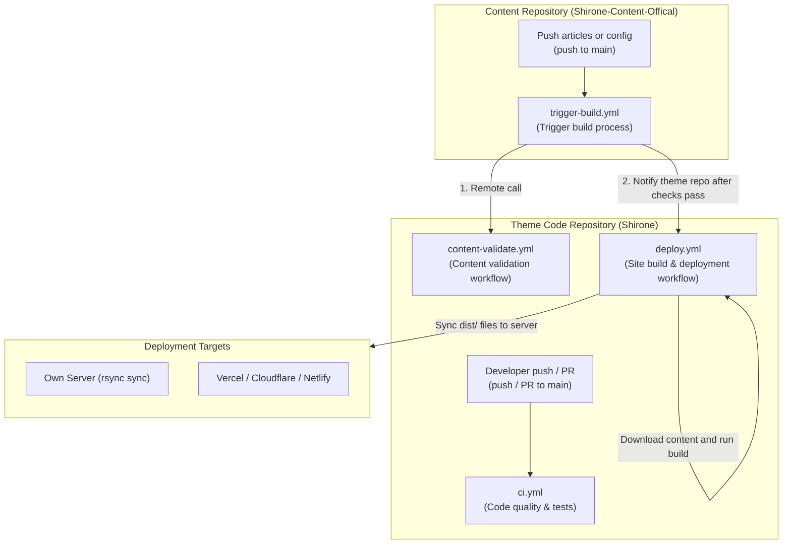
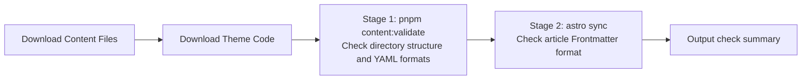

Shirone provides GitHub Actions workflows to test theme code, validate article formatting, and build and deploy the website automatically.



---

## Workflow Overview

| Repository | File Path | Trigger Event | Main Purpose |
| --- | --- | --- | --- |
| **Theme Code Repo** | `.github/workflows/ci.yml` | Code push to `main`, PR, manual dispatch | **Code checks and automated testing**: Checks code style, runs TypeScript type checks, and verifies page rendering. |
| **Theme Code Repo** | `.github/workflows/content-validate.yml` | Invoked by external repositories (`workflow_call`) | **Content validation**: Called by content repos to verify file directory structure, YAML configs, and article frontmatter format. |
| **Theme Code Repo** | `.github/workflows/deploy.yml.example` | Code push, content repository notification, schedule, manual dispatch | **Site build and deployment**: Pulls files from the content repository, builds the site, and syncs the resulting `dist/` web files to servers or hosting platforms. |
| **Content Repo** | `.github/workflows/trigger-build.yml.example` | Push articles or config changes, manual dispatch | **Content update trigger**: Runs validation checks first, then notifies the theme repo to start the build. |

---

## 1. Theme Code Checking Workflow (`ci.yml`)

Located in the theme code repository, `ci.yml` runs automatically whenever code is pushed to `main` or a Pull Request is opened.

### Steps Explanation

1. **Changed file detection (`changes` job)**
   - Compares current changes with previous commits. If only comment code changed, only comment tests run; if styles or fonts changed, style tests run. Unmodified parts are skipped to save time.
2. **Code style check (`quality` job)**
   - Uses Biome to check formatting and code conventions, highlighting annotations on GitHub PR pages.
3. **Framework diagnostics and unit tests (`checks` job)**
   - Checks Astro template syntax and TypeScript types;
   - Checks Svelte component syntax;
   - Runs unit tests for fundamental utilities.
4. **Build verification (`build` job)**
   - Runs `pnpm build` under Node.js 26 to ensure the site builds cleanly after changes.
5. **Browser rendering and comment tests (`comment-tests` job)**
   - Runs headless browsers with Playwright across disabled, Waline, and Twikoo modes to verify page functionality.
6. **Visual style check (`styles` job)**
   - Tests dark/light theme switching, font loading, and page banner display.

---

## 2. Content Validation Workflow (`content-validate.yml`)

If article frontmatter fields have typos or YAML files have indentation errors, building the site can fail.

`content-validate.yml` uses the GitHub Actions reusable workflow mechanism (`workflow_call`) so that content repositories can use validation rules defined in the theme repository.

### Two Validation Stages



1. **Stage 1: Directory structure and configuration check (`pnpm content:validate`)**
   - Verifies standard `content/` and `config/` directories exist;
   - Checks configuration key names and values in `config/*.yaml` files.
2. **Stage 2: Frontmatter metadata check (`astro sync`)**
   - Syncs content into the theme directory and applies Astro collection schemas;
   - Validates categories, tags, dates, and cover images in Markdown posts.
3. **Summary report**
   - Outputs a concise summary on the GitHub Actions page to confirm check results.

---

## 3. Site Build and Deployment Pipeline (`deploy.yml.example`)

`deploy.yml.example` combines theme code and articles to build the site and upload it to your server. Remove the `.example` suffix to activate it.

### Core Mechanisms

- **Multiple trigger events**:
  - Triggers when developers push theme code (documentation changes are ignored);
  - Triggers automatically when notified by the content repository;
  - Can be manually triggered from the GitHub web UI with an optional historical commit ID for rollbacks;
  - Runs once daily on schedule to keep the site in sync.
- **Concurrency control**:
  ```yaml
  concurrency:
    group: deploy
    cancel-in-progress: true
  ```
  If several updates are pushed in a short window, new tasks cancel older queued or running tasks so the site always reflects the latest push.
- **Build caching**:
  - Generated thumbnails are cached so unchanged images are not reprocessed;
  - Article text is not mixed with stale cache files so deleted posts do not linger.
- **Deployment options**:
  The bottom of the file provides ready-to-use snippets for common setups:
  - **Own server**: Uses SSH and `rsync` to incrementally upload files in `dist/` to your server;
  - **Vercel / GitHub Pages**: Uploads pre-built files directly to cloud platforms.

---

## 4. Content Repository Trigger (`trigger-build.yml.example`)

Placed in the independent content repository, this workflow notifies the code repository to build after posts are pushed.

### Workflow Execution

1. **Monitors designated directories**:
   Triggers only when files in `content/` (articles), `config/` (configuration), `data/` (data), or `public/` are modified.
2. **Pre-flight validation (`validate` job)**:
   Calls `content-validate.yml` in the theme repository to check formats before building. Any formatting errors fail directly in the content repository.
3. **Dispatches build notification (`dispatch` job)**:
   Once validation succeeds, sends an event containing the commit ID to the theme code repository to start the build.

---

## Next Steps

- [Server Deployment](/en/guide/deploy/server/): Learn how to synchronize your site to a personal server with GitHub Actions
- [Cross-Repo CI Guide](/en/guide/content-separation/ci-dispatch/): Learn token and permission configuration for dual-repo setups
- [Theme Contribution](/en/guide/development/theme-contributing/): Learn how to modify theme code and add new components
