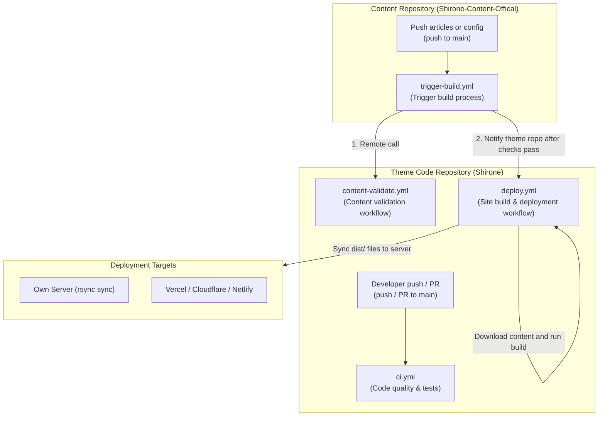

Shirone provides 4 core GitHub Actions workflows located in the theme code repository and the official content repository. This document walks through the YAML source code of each workflow, explaining trigger events, check logic, and build/deployment pipelines line by line.



---

## Workflow Overview

| Repository | File Path | Trigger Event | Main Purpose |
| --- | --- | --- | --- |
| **Theme Code Repo** | `.github/workflows/ci.yml` | Code push to `main`, PR, manual dispatch | **Code checking and automated testing**: Checks code style, runs framework diagnostics, and verifies page rendering. |
| **Theme Code Repo** | `.github/workflows/content-validate.yml` | Invoked by external repositories (`workflow_call`) | **Content validation**: Called by content repos to check directory structure, YAML configs, and article frontmatter format. |
| **Theme Code Repo** | `.github/workflows/deploy.yml.example` | Code push, content repository notification, schedule, manual dispatch | **Site build and deployment**: Merges content and runs the build, syncing the resulting `dist/` web files to servers or hosting platforms. |
| **Content Repo** | `.github/workflows/trigger-build.yml.example` | Push articles or config changes, manual dispatch | **Content update trigger**: Runs validation checks first, then notifies the theme repo to start the build. |

---

## 1. Theme Code Checking Workflow (`ci.yml`)

Located at `.github/workflows/ci.yml` in the theme repository, this workflow runs on every push or Pull Request to `main` to verify code format and prevent regression issues.

### Triggers and Concurrency

```yaml title=".github/workflows/ci.yml"
name: Shirone CI

on:
  push:
    branches: [main]
  pull_request:
    branches: [main]
  workflow_dispatch:

concurrency:
  group: ${{ github.workflow }}-${{ github.event.pull_request.number || github.ref }}
  cancel-in-progress: true

permissions:
  contents: read
```

- `on`: Monitors pushes and Pull Requests targeting the `main` branch, and supports manual triggering via the GitHub web UI;
- `concurrency`: Cancels older in-progress runs when new commits arrive on the same branch or PR;
- `permissions: contents: read`: Grants read-only access to repository code.

### Core Jobs and Code Breakdown

#### Job 1: Path change analysis (`changes`)

Not all code changes require running heavy browser tests. This job determines which test suites are needed:

```yaml title=".github/workflows/ci.yml"
  changes:
    name: Detect changed paths
    runs-on: ubuntu-24.04
    timeout-minutes: 5
    outputs:
      comments: ${{ steps.filter.outputs.comments }}
      styles: ${{ steps.filter.outputs.styles }}
    steps:
      - name: Checkout history for path detection
        uses: actions/checkout@v7
        with:
          fetch-depth: 0

      - name: Classify changed paths
        id: filter
        shell: bash
        run: |
          scripts/ci/classify-browser-suites.sh "$base" "$head" "$GITHUB_OUTPUT"
```

- Outputs `comments=true` if comment system logic was touched;
- Outputs `styles=true` if fonts, banners, or stylesheet files were modified;
- Skips unrelated browser test suites if neither area was touched.

#### Job 2: Code quality check (`quality`)

```yaml title=".github/workflows/ci.yml"
  quality:
    name: Code quality
    runs-on: ubuntu-24.04
    steps:
      - uses: actions/checkout@v7
      - uses: pnpm/action-setup@v6
      - uses: actions/setup-node@v7
        with:
          node-version: 26.13.0
          cache: pnpm
      - run: pnpm install --frozen-lockfile
      - name: Run Biome
        continue-on-error: true
        run: pnpm exec biome ci ./src --reporter=github
```

- Uses Node.js 26 and pnpm to install dependencies;
- Executes Biome to scan `src/` files and report formatting notices on the GitHub PR page.

#### Job 3: Framework diagnostics and unit tests (`checks`)

```yaml title=".github/workflows/ci.yml"
  checks:
    name: Diagnostics and tests
    runs-on: ubuntu-24.04
    steps:
      - uses: actions/checkout@v7
      - uses: pnpm/action-setup@v6
      - uses: actions/setup-node@v7
        with:
          node-version: 26.13.0
          cache: pnpm
      - run: pnpm install --frozen-lockfile

      - name: Check Astro diagnostics
        run: pnpm exec astro check

      - name: Check Svelte diagnostics
        run: pnpm exec svelte-check --tsconfig ./tsconfig.json

      - name: Validate atom manifest
        run: pnpm check:manifest

      - name: Run unit tests
        run: node --test "tests/**/*.test.mjs"
```

- `astro check`: Validates Astro templates and TypeScript types;
- `svelte-check`: Type-checks Svelte components and properties;
- `pnpm check:manifest`: Ensures atom component manifests are complete;
- `node --test`: Runs native lightweight unit tests.

#### Job 4: Browser rendering and style tests (`comment-tests` & `styles`)

```yaml title=".github/workflows/ci.yml"
  comment-tests:
    name: Comment regression fixtures
    needs: changes
    if: needs.changes.outputs.comments == 'true'
    strategy:
      fail-fast: false
      matrix:
        mode: [disabled, waline, twikoo, no-toc]
    steps:
      - uses: actions/checkout@v7
      - uses: pnpm/action-setup@v6
      - uses: actions/setup-node@v7
      - run: pnpm install --frozen-lockfile
      - name: Run comment tests
        run: pnpm exec playwright test tests/site/comments.spec.ts
```

- Receives change detection outputs from the `changes` job;
- Uses a matrix to run Playwright browser tests across disabled, Waline, Twikoo, and no-toc configurations.

---

## 2. Reusable Content Validation Workflow (`content-validate.yml`)

Located at `.github/workflows/content-validate.yml` in the theme repository, this workflow is defined as a reusable workflow (`workflow_call`). Content repositories invoke it on push to catch formatting and configuration errors before deployment.

### Source Code and Breakdown

```yaml title=".github/workflows/content-validate.yml"
name: Validate content

on:
  workflow_call:
    inputs:
      theme_repository:
        description: "Theme repository in OWNER/REPO format"
        type: string
        required: true
      theme_ref:
        description: "Branch or ref of the theme repository"
        type: string
        required: false
        default: main
    secrets:
      theme_token:
        description: "Token for private theme repositories"
        required: false

jobs:
  validate:
    name: Schema and structure
    runs-on: ubuntu-latest
    steps:
      # 1. Download caller (content repo) files into content/
      - name: Checkout content
        uses: actions/checkout@v4
        with:
          path: content

      # 2. Download theme repository code into theme/
      - name: Checkout theme
        uses: actions/checkout@v4
        with:
          repository: ${{ inputs.theme_repository }}
          ref: ${{ inputs.theme_ref }}
          path: theme
          token: ${{ secrets.theme_token || github.token }}

      # 3. Read pinned pnpm version from theme package.json
      - name: Set up pnpm
        uses: pnpm/action-setup@v4
        with:
          package_json_file: theme/package.json
          run_install: false

      - name: Set up Node.js
        uses: actions/setup-node@v4
        with:
          node-version: 26.13.0
          cache: pnpm
          cache-dependency-path: theme/pnpm-lock.yaml

      - name: Install dependencies
        working-directory: theme
        run: pnpm install --frozen-lockfile --prefer-offline

      # 4. Stage 1: Validate directory structure and config/*.yaml files
      - name: Validate content structure and config
        working-directory: theme
        env:
          CONTENT_DIR: ${{ github.workspace }}/content
        run: pnpm content:validate

      # 5. Stage 2: Validate Markdown frontmatter schemas
      - name: Validate frontmatter schemas
        working-directory: theme
        env:
          CONTENT_DIR: ${{ github.workspace }}/content
        run: |
          set -euo pipefail
          pnpm content:sync
          pnpm exec astro sync

      # 6. Generate summary report
      - name: Summarize
        if: always()
        working-directory: theme
        run: |
          {
            echo "### Content validation"
            echo "- Theme: \`${{ inputs.theme_repository }}@${{ inputs.theme_ref }}\`"
          } >> "$GITHUB_STEP_SUMMARY"
```

### Key Mechanisms

- **Dual Checkout**: Downloads the content repository into `content/` and the theme repository into `theme/`;
- **Structure & Config Validation (`pnpm content:validate`)**: Checks that required folders exist and that `config/*.yaml` files conform to schemas;
- **Frontmatter Validation (`astro sync`)**: Syncs articles and runs Astro collection schemas to verify category, tag, date, and image formats;
- **Step Summary**: Writes a summary report to the GitHub Actions page for quick inspection.

---

## 3. Site Build and Deployment Pipeline (`deploy.yml.example`)

Located at `.github/workflows/deploy.yml.example` in the theme repository, rename it to `deploy.yml` to enable production deployment.

### Triggers and Concurrency

```yaml title=".github/workflows/deploy.yml.example"
name: Deploy

on:
  push:
    branches: [main]
    paths-ignore:
      - "docs/**"
      - "rules/**"
      - "*.md"
  repository_dispatch:
    types: [content-updated]
  workflow_dispatch:
    inputs:
      content_ref:
        description: "Content commit SHA or ref (leave empty for main)"
        required: false
        default: ""
  schedule:
    - cron: "17 4 * * *"

concurrency:
  group: deploy
  cancel-in-progress: true
```

- `paths-ignore`: Skips builds when only documentation files are modified;
- `repository_dispatch`: Listens for `content-updated` events dispatched by the content repository;
- `workflow_dispatch`: Allows manual runs from the GitHub UI with an optional historical commit ID for rollbacks;
- `schedule`: Runs once daily to ensure the site stays in sync;
- `concurrency`: Cancels older queued or running tasks when new pushes arrive, preventing out-of-order deployments.

### Execution Steps Breakdown

```yaml title=".github/workflows/deploy.yml.example"
jobs:
  deploy:
    name: Build and deploy
    runs-on: ubuntu-latest
    env:
      CI: true
      CONTENT_DIR: .content-src

    steps:
      # 1. Resolve content commit SHA (uses payload SHA if provided)
      - name: Resolve content ref
        id: target
        env:
          PAYLOAD_SHA: ${{ github.event.client_payload.sha }}
          INPUT_REF: ${{ github.event.inputs.content_ref }}
        run: |
          set -euo pipefail
          ref="${PAYLOAD_SHA:-}"
          [ -n "$ref" ] || ref="${INPUT_REF:-}"
          [ -n "$ref" ] || ref="main"
          echo "ref=$ref" >> "$GITHUB_OUTPUT"

      # 2. Checkout theme code
      - name: Checkout theme
        uses: actions/checkout@v4

      # 3. Checkout specified content commit
      - name: Checkout content
        uses: actions/checkout@v4
        with:
          repository: ${{ env.CONTENT_REPOSITORY }}
          ref: ${{ steps.target.outputs.ref }}
          path: ${{ env.CONTENT_WORKING_COPY }}
          token: ${{ secrets.CONTENT_REPO_TOKEN }}

      # 4. Set up pnpm and Node.js
      - uses: pnpm/action-setup@v4
      - uses: actions/setup-node@v4
        with:
          node-version: 26.13.0
          cache: pnpm

      # 5. Restore thumbnail cache to accelerate builds
      - name: Restore build caches
        uses: actions/cache@v4
        with:
          path: public/assets/moments/thumbnails
          key: ${{ runner.os }}-shirone-thumbnails-${{ hashFiles('pnpm-lock.yaml') }}
          restore-keys: ${{ runner.os }}-shirone-thumbnails-

      - name: Install dependencies
        run: pnpm install --frozen-lockfile --prefer-offline

      # 6. Synchronize content files into the theme directory
      - name: Materialize content and config
        run: pnpm content:sync

      # 7. Build production site into dist/
      - name: Build site
        run: pnpm build

      # 8. Deploy to server via rsync
      - name: Deploy to server
        env:
          DEPLOY_HOST: ${{ secrets.DEPLOY_HOST }}
          DEPLOY_USER: ${{ secrets.DEPLOY_USER }}
          DEPLOY_SSH_KEY: ${{ secrets.DEPLOY_SSH_KEY }}
          DEPLOY_DIR: /var/www/shirone
        run: |
          set -euo pipefail
          mkdir -p ~/.ssh && chmod 700 ~/.ssh
          printf '%s\n' "$DEPLOY_SSH_KEY" > ~/.ssh/deploy_key
          chmod 600 ~/.ssh/deploy_key
          ssh-keyscan -H "$DEPLOY_HOST" >> ~/.ssh/known_hosts
          rsync -az --delete -e "ssh -i ~/.ssh/deploy_key" \
            dist/ "$DEPLOY_USER@$DEPLOY_HOST:$DEPLOY_DIR/dist/"
```

- **Commit Resolution**: Reads `sha` safely via environment variables to avoid shell injection;
- **Thumbnail Caching**: Uses `actions/cache` to reuse previously generated image thumbnails;
- **Content Sync (`pnpm content:sync`)**: Merges files from the content repository into standard theme paths before compilation;
- **Incremental Sync (`rsync`)**: Uses SSH keys to sync only modified static files from `dist/` to the server.

---

## 4. Content Repository Trigger (`trigger-build.yml.example`)

Located at `.github/workflows/trigger-build.yml.example` in the content repository, rename it to `trigger-build.yml` in your content repo to enable decoupled builds.

### Source Code and Breakdown

```yaml title=".github/workflows/trigger-build.yml.example"
name: Trigger Theme Build

on:
  push:
    branches:
      - main
    paths:
      - "content/**"
      - "config/**"
      - "data/**"
      - "assets/**"
      - "public/**"
      - "shirone.content.json"
  workflow_dispatch: {}

concurrency:
  group: trigger-build
  cancel-in-progress: true

jobs:
  # Step 1: Run pre-flight content validation
  validate:
    uses: LyraVoid/Shirone/.github/workflows/content-validate.yml@main
    with:
      theme_repository: LyraVoid/Shirone
      theme_ref: main

  # Step 2: Notify the theme repo to build once validation passes
  dispatch:
    needs: validate
    runs-on: ubuntu-latest
    timeout-minutes: 5
    steps:
      - name: Dispatch build event to theme repository
        env:
          DISPATCH_TOKEN: ${{ secrets.DISPATCH_TOKEN }}
        if: ${{ env.DISPATCH_TOKEN != '' }}
        uses: peter-evans/repository-dispatch@v4
        with:
          token: ${{ env.DISPATCH_TOKEN }}
          repository: LyraVoid/Shirone
          event-type: content-updated
          # Pass the commit SHA so the theme repo builds this exact version
          client-payload: '{"sha": "${{ github.sha }}"}'
```

### Key Mechanisms

1. **Path filters**: Triggers only when files inside `content/`, `config/`, `data/`, or `public/` change;
2. **Pre-flight validation (`needs: validate`)**: Formatting errors fail the job immediately in the content repo before triggering downstream builds;
3. **Commit ID passing**: Injects `github.sha` into `client-payload`, enabling the theme repository to check out the exact commit.

---

## Next Steps

- [Server Deployment](/en/guide/deploy/server/): Learn how to synchronize your site to a personal server with GitHub Actions
- [Cross-Repo CI Guide](/en/guide/content-separation/ci-dispatch/): Learn token and permission configuration for dual-repo setups
- [Theme Contribution](/en/guide/development/theme-contributing/): Learn how to modify theme code and add new components
