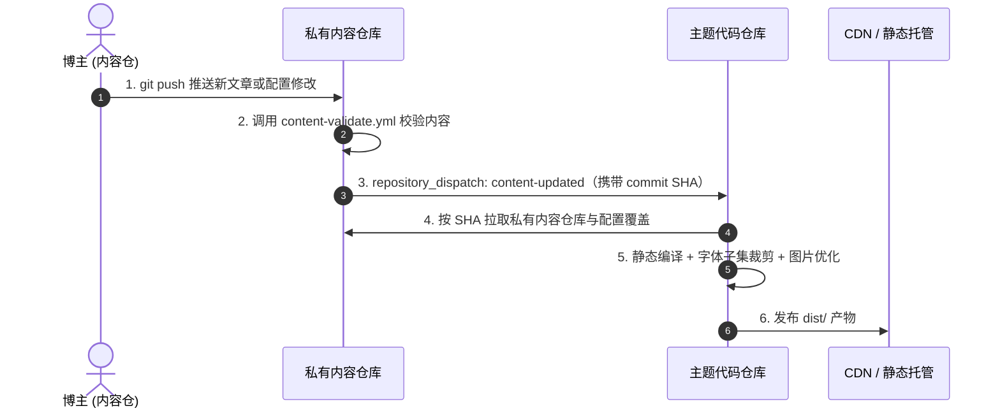

这是官方推荐的自动化部署方案。内容仓推送后先校验内容，再通过 `repository_dispatch` 通知主题代码仓拉取指定提交、构建并发布。

优先使用现成模板，不要另写简化版工作流。主题代码仓和内容仓都提供了可以直接启用的完整文件：

- 内容仓：`.github/workflows/trigger-build.yml.example`
- 主题代码仓：`.github/workflows/deploy.yml.example`



---

## 配置步骤

::: steps
1. **生成派发用 PAT（放在内容仓）**

   内容仓需要向主题代码仓发送 `repository_dispatch`：

   - 登录 GitHub，点击右上角头像 -> **Settings** -> **Developer settings**；
   - 选择 **Personal access tokens** -> **Fine-grained tokens**；
   - **Repository access**：选择 **Only select repositories**，勾选==主题代码仓库==；
   - **Permissions** -> **Repository permissions** -> **Contents** 设为==Read and write=={.error}；
   - 生成并立即保存令牌。

   > [!CAUTION] 访问令牌安全保管
   > 令牌只展示一次，==绝不能明文写进代码或公开文件=={.error}，只能放进 GitHub Encrypted Secrets。

2. **在内容仓配置 `DISPATCH_TOKEN`**

   进入==私有内容仓库== -> **Settings** -> **Secrets and variables** -> **Actions** -> **New repository secret**：

   - **Name**：`DISPATCH_TOKEN`（区分大小写）
   - **Secret**：粘贴上一步的 PAT

   如果主题代码仓也是私有的，校验工作流 checkout 主题仓时还需要一个 `THEME_REPO_TOKEN`（对主题仓 `Contents: Read`）。

3. **给主题仓配置 `CONTENT_REPO_TOKEN`（内容仓私有时的必需项）**

   进入==主题代码仓库== -> **Settings** -> **Secrets and variables** -> **Actions**，添加：

   - **Name**：`CONTENT_REPO_TOKEN`
   - **Secret**：对私有内容仓有 `Contents: Read` 权限的 PAT

   `deploy.yml.example` 用它 checkout 内容仓。不要把 `DISPATCH_TOKEN` 和 `CONTENT_REPO_TOKEN` 配到同一个仓库，它们的作用方向相反。

4. **启用内容仓触发工作流**

   把内容仓模板复制为正式文件：

   ```bash
   cp .github/workflows/trigger-build.yml.example .github/workflows/trigger-build.yml
   ```

   然后把模板中的 `LyraVoid/Shirone` / `YOUR_THEME_REPO` 替换成你的主题仓：

   ```yaml title=".github/workflows/trigger-build.yml（关键部分）"
   on:
     push:
       branches: [main]
       paths:
         - "content/**"
         - "config/**"
         - "data/**"
         - "assets/**"
         - "public/**"
         - "shirone.content.json"
     workflow_dispatch: {}

   concurrency:
     group: trigger-build
     cancel-in-progress: true

   jobs:
     validate:
       uses: YOUR_NAME/YOUR_THEME_REPO/.github/workflows/content-validate.yml@main
       with:
         theme_repository: YOUR_NAME/YOUR_THEME_REPO
         theme_ref: main

     dispatch:
       needs: validate
       runs-on: ubuntu-latest
       steps:
         - uses: peter-evans/repository-dispatch@v4
           with:
             token: ${{ secrets.DISPATCH_TOKEN }}
             repository: YOUR_NAME/YOUR_THEME_REPO
             event-type: content-updated
             client-payload: '{"sha": "${{ github.sha }}"}'
   ```

   要点：

   - 事件名必须是 `content-updated`（过去式），不是 `content-update`。
   - `client-payload` 必须带上 `sha`，否则连续推送时主题仓可能拉到内容仓的旧 HEAD。
   - `validate` 先调用 `content-validate.yml`，内容有错误时会在派发前失败，避免一次无效的完整构建。
   - `concurrency` 保证高频推送只保留最新一次派发。

5. **启用主题仓部署工作流**

   把主题仓的 `deploy.yml.example` 复制为 `.github/workflows/deploy.yml`，然后按文件内注释选择部署变体（Vercel、GitHub Pages、服务器 rsync、平台 Deploy Hook）。公共部分已经包含：

   ```yaml title=".github/workflows/deploy.yml（关键部分）"
   on:
     push:
       branches: [main]
     repository_dispatch:
       types: [content-updated]
     workflow_dispatch:
     schedule:
       - cron: "17 4 * * *"

   concurrency:
     group: deploy
     cancel-in-progress: true

   env:
     CONTENT_REPOSITORY: YOUR_NAME/YOUR_CONTENT_REPO
     CONTENT_WORKING_COPY: .content-src
   ```

   构建步骤如下：checkout 主题仓，用 `CONTENT_REPO_TOKEN` 把内容仓 checkout 到 `.content-src`，然后依次执行 `pnpm install --frozen-lockfile`、`pnpm content:sync`、`pnpm anime:sync --if-stale` 和 `pnpm build`。

   `deploy.yml.example` 会优先使用 `github.event.client_payload.sha` 作为内容仓 ref，其次用 `workflow_dispatch` 的 `content_ref`，最后回退到 `main`。不要在这里写死 `main`，否则会丢掉派发携带的提交信息。
:::

---

## 双仓配置落在哪

- 站点配置：优先放在内容仓的 `config/site.yaml`，构建时覆盖 `src/user/user-config.ts`。单仓模式才直接改 `src/config/siteConfig.ts`。
- 内容目录：`content/posts`、`content/moments`、`content/series`、`content/spec` 会映射到主题仓对应目录。
- 数据与媒体：`data/`、`assets/`、`public/` 由 `content:sync` 同步。
- 文档目录：内容仓的 `docs/` 不参与构建，修改它不会触发 `paths` 过滤。

---

## 验证自动化流水线

::: steps
1. 在内容仓新建或修改一篇 Markdown 文章；
2. 执行 `git add .`、`git commit -m "docs: test dispatch"` 并 `git push`；
3. 打开内容仓 **Actions**，确认 `Trigger Theme Build` 的 `validate` 与 `dispatch` 都成功；
4. 打开主题仓 **Actions**，确认收到 `content-updated` 并完成部署；
5. 检查线上文章是否与刚推送的提交一致。
:::

---

## 下一步

- 前往 [云托管平台 Deploy Hook 部署](/guide/content-separation/deploy-hooks/)：了解 Cloudflare Pages、Vercel、EdgeOne 与 Netlify 的集成方案
