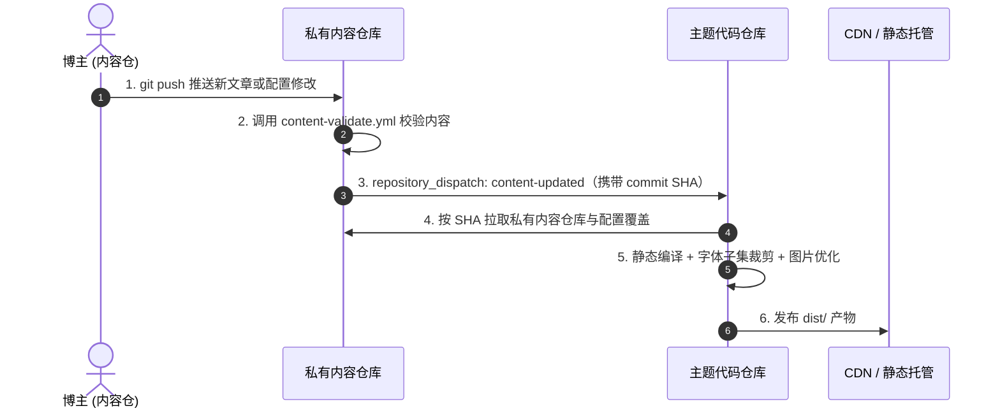

这是官方最推荐的双仓自动化部署方案。内容仓库每次推送文章或配置修改后，会先在内容仓完成语法预检，随后向主题代码仓库派发 `repository_dispatch` 事件；主题代码仓接收到信号后，自动拉取指定提交的内容与配置，完成静态打包、字体子集裁剪并发布上线。

优先使用官方提供的现成模板，不要手写简化版工作流。两个仓库均已提供开箱即用的完整示例：

- 内容仓库：`.github/workflows/trigger-build.yml.example`
- 主题代码仓：`.github/workflows/deploy.yml.example`



---

## 第一步：申请 GitHub 个人访问令牌（PAT）

内容仓库每次提交后，需要向主题代码仓库发送 `repository_dispatch` 派发事件。由于该操作跨越了两个仓库，我们需要在 GitHub 申请一个具备目标主题仓读写权限的**细粒度个人访问令牌（Fine-grained Personal Access Token）**。

::: steps
1. **前往个人设置**

   登录 GitHub，点击页面右上角个人头像，在下拉菜单中点击 **Settings**。

   

2. **进入开发者设置**

   在左侧设置导航滑到底部，点击 **Developer Settings**。

   

   

3. **进入细粒度令牌管理**

   在左侧导航依次展开 **Personal access tokens**，点击 **Fine-grained tokens**。

   

4. **新建个人访问令牌**

   点击页面右上角的 **Generate new token** 按钮。

   

5. **配置令牌属性与生效仓库**

   在表单中填写基本信息并限定权限范围：

   - **Token name**：填入易记的名称（如 `DISPATCH_TOKEN`）；
   - **Expiration**：选择过期时间（建议 90 天，也可按需自定义）；
   - **Repository access**：**务必勾选 Only select repositories**，并在下拉搜索框中**只选择你的主题代码仓库**。

   

   > [!IMPORTANT] 为什么必须选「主题代码仓库」
   > 派发事件是要通知主题代码仓触发 Actions 的，因此令牌必须对**主题代码仓**具备控制权限，切勿选错成内容仓。

6. **赋予 Contents 读写权限**

   向下滚动展开 **Permissions** 下的 **Repository permissions** 列表：
   - 找到 **Contents** 权限项；
   - 将下拉权限由只读（No access）修改为 **Read and write**（用于触发跨仓流水线派发）。

   

7. **生成并妥善复制令牌**

   滑动到页面最底部，点击绿色按钮 **Generate token**。生成成功后，**立即点击复制按钮保存令牌字符串**。

   

   > [!CAUTION] 令牌仅展示一次
   > 离开页面后 GitHub 将不再展示该令牌明文。请妥善保存该字符串，切勿将令牌提交到任何公开仓库或 Markdown 文件中。
:::

---

## 第二步：在仓库中配置 Secret 凭据

双仓架构中涉及到两类凭据，两者的作用方向相反，请对照下表理清配置位置：

| 凭据名称 | 授权目标仓库 | 权限要求 | 配置在哪个仓库 | 用途说明 |
| :--- | :--- | :--- | :--- | :--- |
| `DISPATCH_TOKEN` | 主题代码仓 | `Contents: Read and write` | **内容仓库** | 内容更新后向主题仓派发构建信号（必配） |
| `CONTENT_REPO_TOKEN` | 私有内容仓 | `Contents: Read` | **主题代码仓** | 主题仓 Actions 拉取私有内容与配置（仅内容仓私有时需要） |

### 配置方法

在 GitHub 仓库添加 Secret 的操作步骤如下：

::: steps
1. **进入仓库设置**

   打开目标仓库（例如你的私有内容仓库），点击顶部导航栏的 **Settings**。

   

2. **进入 Actions Secrets 菜单**

   在左侧菜单展开 **Secrets and variables**，选择 **Actions**。

   

3. **创建 Repository Secret**

   点击页面右侧绿色的 **New repository secret** 按钮：
   - **Name**：填入密钥名称（如 `DISPATCH_TOKEN`，注意大小写一致）；
   - **Secret**：粘贴第一步中申请并复制的 PAT 字符串；
   - 点击底部的 **Add secret** 保存。

   
:::

> [!TIP] 私有内容仓补充凭据
> 如果你的内容仓是私有仓库，主题代码仓在拉取文章时同样需要权限。请按照上述相同步骤在 GitHub 申请一个对内容仓具备 `Contents: Read` 权限的 PAT，并在**主题代码仓库**的 Secrets 中添加名为 `CONTENT_REPO_TOKEN` 的凭据。

---

## 第三步：启用内容仓触发工作流

将内容仓库中的示例工作流复制为正式文件：

```bash
cp .github/workflows/trigger-build.yml.example .github/workflows/trigger-build.yml
```

编辑 `.github/workflows/trigger-build.yml`，将其中的仓库占位符替换为你实际的主题代码仓（例如 `yourname/Shirone`）：

```yaml title=".github/workflows/trigger-build.yml（核心部分）"
on:
  push:
    branches: [main]
    paths:
      - "content/**"
      - "config/**"
      - "data/**"
      - "assets/**"
      - "public/**"
      - "shirone.content.json"
  workflow_dispatch: {}

concurrency:
  group: trigger-build
  cancel-in-progress: true

jobs:
  validate:
    uses: yourname/Shirone/.github/workflows/content-validate.yml@main
    with:
      theme_repository: yourname/Shirone
      theme_ref: main

  dispatch:
    needs: validate
    runs-on: ubuntu-latest
    steps:
      - uses: peter-evans/repository-dispatch@v4
        with:
          token: ${{ secrets.DISPATCH_TOKEN }}
          repository: yourname/Shirone
          event-type: content-updated
          client-payload: '{"sha": "${{ github.sha }}"}'
```

**配置要点说明**：
- **`event-type`**：必须是 `content-updated`（过去式），不能拼错为 `content-update`。
- **`client-payload`**：必须携带 `sha: ${{ github.sha }}`，确保高频推送时主题仓精准拉取本次提交，避免拉到旧缓存。
- **`validate` 任务**：在派发前先调用主题仓的校验工作流，一旦 Markdown 或 YAML 有语法错误会在派发前拦截报错，避免无效打包。
- **`concurrency`**：多次连续推文时自动截断旧任务，只保留最新一次派发，节省 Actions 额度。

---

## 第四步：启用主题仓部署流水线

进入主题代码仓库，将 `deploy.yml.example` 复制为 `.github/workflows/deploy.yml`，然后根据你使用的托管平台取消末尾对应方案的注释：

```yaml title=".github/workflows/deploy.yml（核心部分）"
on:
  push:
    branches: [main]
  repository_dispatch:
    types: [content-updated]
  workflow_dispatch:
  schedule:
    - cron: "17 4 * * *"

concurrency:
  group: deploy
  cancel-in-progress: true

env:
  CONTENT_REPOSITORY: yourname/my-blog-content
  CONTENT_WORKING_COPY: .content-src
```

构建步骤会自动检出主题代码仓，并通过 `CONTENT_REPO_TOKEN` 将内容仓同步到 `.content-src` 目录，随后依次执行依赖安装、内容同步、追番缓存拉取与静态打包。

::: warning 选定部署方案后，别忘了同步修改平台设置
`deploy.yml.example` 末尾提供了四种常见部署方案，对应的平台配置各有不同，配置不一致往往会导致部署失败：

- **方案 A（部署到 Vercel：Actions 直传产物）**：由 Actions 打包后直接向 Vercel 交付 `dist/` 纯静态文件。使用该方案前，必须先把 Vercel 项目改成纯静态托管：在后台将 Framework Preset 改为 `Other`、清空 Build Command，并断开 Git 连接。因为上传的 `dist/` 目录里没有 `package.json`，残留的构建命令会导致云端报错 `Error: Command "pnpm build" exited with 1`。

- **方案 B / C（GitHub Pages / 服务器 rsync）**：平台只负责接收静态文件，无需平台侧构建配置。

- **方案 D（平台 Deploy Hook）**：与方案 A 刚好相反，平台**需要保留**构建命令 `pnpm build`，并在平台控制台配置好 `CONTENT_REPO_URL` 与 `GIT_TERMINAL_PROMPT=0`。

注意：方案 A 与方案 D 只能二选一，不能同时开启，否则一次内容提交会同时触发两次部署。
:::

---

## 双仓配置落在哪

双仓模式下，主题代码与文章配置物理隔离：

- **站点配置**：优先存放在内容仓的 `config/site.yaml`，构建时自动覆盖主题默认值。单仓模式才直接改 `src/config/siteConfig.ts`。
- **内容目录**：`content/posts`、`content/moments`、`content/series`、`content/spec` 会自动映射至主题代码仓。
- **数据与静态媒体**：`data/`、`assets/`、`public/` 均由 `content:sync` 工具全自动对齐同步。
- **文档目录**：内容仓自带的 `docs/` 不参与打包构建，修改它不会触发构建推送。

---

## 验证自动化流水线

::: steps
1. **推送测试文章**

   在内容仓库新建或修改任意一篇 Markdown 文章，执行提交并推送：
   ```bash
   git add .
   git commit -m "docs: 测试跨仓自动构建"
   git push origin main
   ```

2. **检查内容仓派发状态**

   打开内容仓库的 **Actions** 标签页，确认 `Trigger Theme Build` 的校验（`validate`）与派发（`dispatch`）步骤均显示绿色对勾。

3. **检查主题仓构建部署**

   打开主题代码仓的 **Actions** 标签页，确认收到了 `content-updated` 事件并顺利完成全量打包与部署发布。

4. **线上验证**

   刷新你的博客网站，确认新提交的文章或配置已实时渲染展示。
:::

---

## 下一步

- 前往 [云托管平台 Deploy Hook 部署](/guide/content-separation/deploy-hooks/)：了解 Cloudflare Pages、Vercel、EdgeOne 与 Netlify 的集成方案
