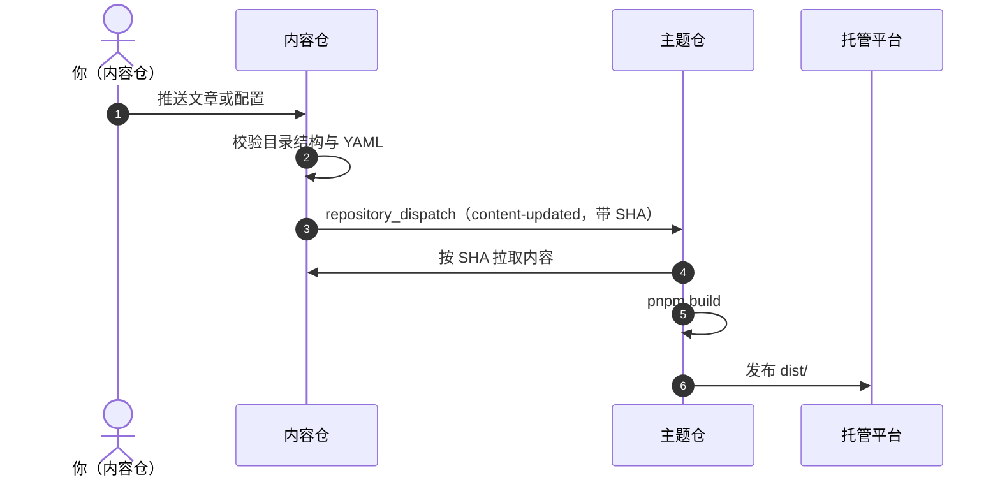

内容仓推送更新后，由内容仓的 GitHub Actions 工作流向主题仓发送派发事件；主题仓按指定 commit SHA 检出内容并执行构建与发布。该方案能精确按某次提交重现构建，适合内容仓更新频繁、且要求可控构建环境的场景。



两个仓库均已提供预设的工作流模板，直接复制重命名即可，无需自行简写：

- 内容仓模板：`.github/workflows/trigger-build.yml.example`
- 主题仓模板：`.github/workflows/deploy.yml.example`

## 准备两个令牌

| 密钥名称 | 配置仓库 | 所需权限 |
| --- | --- | --- |
| `DISPATCH_TOKEN` | **内容仓** | 主题仓 `Contents: Read and write` |
| `CONTENT_REPO_TOKEN` | **主题仓** | 内容仓 `Contents: Read`（内容仓为公开时可省略） |

详细申请流程见[申请个人访问令牌](/guide/content-separation/pat/)。

## 第一步：启用内容仓工作流

在内容仓根目录中，将示例文件复制为正式工作流：

```bash
cp .github/workflows/trigger-build.yml.example .github/workflows/trigger-build.yml
```

随后修改工作流中的两处仓库名称：

```yaml title=".github/workflows/trigger-build.yml（需修改部分）"
jobs:
  validate:
    uses: 你的用户名/Shirone/.github/workflows/content-validate.yml@main
    with:
      theme_repository: 你的用户名/Shirone

  dispatch:
    needs: validate
    runs-on: ubuntu-latest
    steps:
      - uses: peter-evans/repository-dispatch@v4
        with:
          token: ${{ secrets.DISPATCH_TOKEN }}
          repository: 你的用户名/Shirone
          event-type: content-updated
          client-payload: '{"sha": "${{ github.sha }}"}'
```

配置要点：

- `event-type` 必须精确保持为 `content-updated`；
- `client-payload` 必须附带 `sha`，避免在连续推送时拉取到历史 commit；
- `validate` 步骤会在事件派发前调用主题仓的校验工作流，内容校验未通过时直接阻断构建。

该工作流默认监听 `content/`、`config/`、`data/`、`assets/`、`public/` 与 `shirone.content.json` 的文件改动。仅修改内容仓的 README 不会触发构建。

## 第二步：配置仓库密钥

**内容仓**：进入 Settings -> Secrets and variables -> Actions，新建 `DISPATCH_TOKEN`。

**主题仓**：在同一页面新建 `CONTENT_REPO_TOKEN`，填入具备内容仓读取权限的访问令牌。


## 第三步：启用主题仓部署流水线

在主题仓根目录下执行：

```bash
cp .github/workflows/deploy.yml.example .github/workflows/deploy.yml
```

将文件开头的 `CONTENT_REPOSITORY` 替换为您个人的内容仓地址：

```yaml title=".github/workflows/deploy.yml（需修改部分）"
env:
  CONTENT_REPOSITORY: 你的用户名/my-blog-content
  CONTENT_WORKING_COPY: .content-src
```

随后处理文件末尾的部署步骤。模板预设了四种常见方案，取消注释对应方案即可，其余方案保持注释状态：

| 变体 | 适用场景 |
| --- | --- |
| 变体 A | 使用 `vercel deploy dist --prod` 直接交付预构建产物 |
| 变体 B | 直接发布至 GitHub Pages |
| 变体 C | 使用 rsync 同步至自建服务器 |
| 变体 D | 调用托管平台的 Deploy Hook，交由平台执行构建 |

采用变体 A、B、C 时，托管平台仅充当纯静态托管服务，必须在平台控制台关闭平台自带的构建。

采用变体 D 时，托管平台需保留 `pnpm build` 命令，并配置 `CONTENT_REPO_URL`。

两种构建方式不可同时启用，否则单次推送会引发重复构建。各平台的具体设置见[部署总览](/guide/deploy/overview/)与[部署钩子](/guide/content-separation/deploy-hooks/)。

## 第四步：验证

1. 在内容仓中修改任意文章，提交并推送到远端：

   ```bash
   git add .
   git commit -m "docs: 测试自动构建"
   git push origin main
   ```

2. 打开内容仓的 **Actions** 页面，确认 `Trigger Theme Build` 的 `validate` 与 `dispatch` 均为成功状态；
3. 打开主题仓的 **Actions** 页面，确认已接收到 `content-updated` 事件并完成完整构建；
4. 刷新博客站点，核对更新内容是否已正常展示。

若流程中断，优先检查对应仓库的 Actions 运行日志。令牌权限异常通常在派发或检出步骤报错，详见[常见问题](/guide/content-separation/faq/)。

## 下一步

[部署总览](/guide/deploy/overview/)：选择部署平台，完成站点上线。

若不想维护 GitHub Actions，可改用[部署钩子](/guide/content-separation/deploy-hooks/)，让托管平台自行拉取构建。
