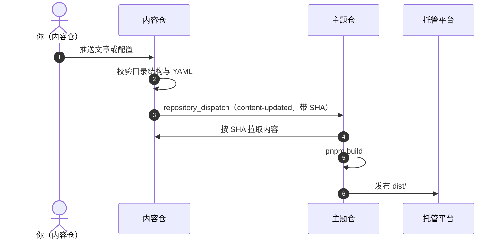

内容仓推送更新后，由内容仓的 GitHub Actions 工作流向主题仓发送派发事件；主题仓按指定 commit SHA 检出内容并执行构建与发布。该方案能精确按某次提交重现构建，适合内容仓更新频繁、且要求可控构建环境的场景。



两个仓库均已提供预设的工作流模板，直接复制重命名即可，无需自行简写：

- 内容仓模板：`.github/workflows/trigger-build.yml.example`
- 主题仓模板：`.github/workflows/deploy.yml.example`

## 准备两个令牌

| 密钥名称 | 配置仓库 | 所需权限 |
| --- | --- | --- |
| `DISPATCH_TOKEN` | **内容仓** | 主题仓 `Contents: Read and write` |
| `CONTENT_REPO_TOKEN` | **主题仓** | 内容仓 `Contents: Read`（内容仓为公开时可省略） |

详细申请流程见[申请个人访问令牌](/guide/content-separation/pat/)。

## 第一步：启用内容仓工作流

在内容仓根目录中，将示例文件复制为正式工作流：

```bash
cp .github/workflows/trigger-build.yml.example .github/workflows/trigger-build.yml
```

随后修改工作流中的两处仓库名称：

```yaml title=".github/workflows/trigger-build.yml（需修改部分）"
jobs:
  validate:
    uses: 你的用户名/Shirone/.github/workflows/content-validate.yml@main
    with:
      theme_repository: 你的用户名/Shirone

  dispatch:
    needs: validate
    runs-on: ubuntu-latest
    steps:
      - uses: peter-evans/repository-dispatch@v4
        with:
          token: ${{ secrets.DISPATCH_TOKEN }}
          repository: 你的用户名/Shirone
          event-type: content-updated
          client-payload: '{"sha": "${{ github.sha }}"}'
```

配置要点：

- `event-type` 必须精确保持为 `content-updated`；
- `client-payload` 必须附带 `sha`，避免在连续推送时拉取到历史 commit；
- `validate` 步骤会在事件派发前调用主题仓的校验工作流，内容校验未通过时直接阻断构建。

该工作流默认监听 `content/`、`config/`、`data/`、`assets/`、`public/` 与 `shirone.content.json` 的文件改动。仅修改内容仓的 README 不会触发构建。

## 第二步：配置仓库密钥

**内容仓**：进入 Settings -> Secrets and variables -> Actions，新建 `DISPATCH_TOKEN`。

**主题仓**：在同一页面新建 `CONTENT_REPO_TOKEN`，填入具备内容仓读取权限的访问令牌。


## 第三步：启用主题仓部署流水线

在主题仓根目录下执行复制命令，去掉文件结尾的 `.example` 后缀：

```bash
cp .github/workflows/deploy.yml.example .github/workflows/deploy.yml
```

首先修改文件开头的 `CONTENT_REPOSITORY`，替换为你个人的内容仓库地址：

```yaml title=".github/workflows/deploy.yml（需修改部分）"
env:
  CONTENT_REPOSITORY: 你的用户名/my-blog-content
  CONTENT_WORKING_COPY: .content-src
```

随后打开该文件滑动到最底部。模板末尾预置了四种发布方式的代码片段（默认带有 `#` 注释）。请根据你的部署目标选择其中一种，**删掉对应方案前面的 `#` 注释符启用它，并保持其他方案为注释状态**。

### 方案 A：发布到 Vercel（直接交付打包网页）

适用于网站托管在 Vercel 平台，但希望由 GitHub Actions 在云端完成编译打包的场景。

```yaml title=".github/workflows/deploy.yml（方案 A）"
      - name: Deploy to Vercel
        run: |
          pnpm dlx vercel@latest deploy dist --prod --yes \
            --token "$VERCEL_TOKEN"
        env:
          VERCEL_TOKEN: ${{ secrets.VERCEL_TOKEN }}
          VERCEL_ORG_ID: ${{ secrets.VERCEL_ORG_ID }}
          VERCEL_PROJECT_ID: ${{ secrets.VERCEL_PROJECT_ID }}
```

- **需要配置的密钥 (Secrets)**：在主题仓的 Actions 设置中添加 `VERCEL_TOKEN`、`VERCEL_ORG_ID` 和 `VERCEL_PROJECT_ID`；
- **平台设置要求**：进入 Vercel 控制台，在项目设置中清空 Build Command 并关闭自动构建，避免 Vercel 重复打包；
- **详细参考**：[Vercel 部署指南](/guide/deploy/vercel/)。

### 方案 B：发布到 GitHub Pages（免费静态托管）

适用于直接使用 GitHub 提供的免费 Pages 静态网页托管服务。

使用此方案时，先修改 `deploy.yml` 顶部的权限声明，加入 `pages: write` 与 `id-token: write`：

```yaml title=".github/workflows/deploy.yml（顶部 permissions 需修改）"
permissions:
  contents: read
  pages: write
  id-token: write
```

随后启用文件末尾对应的 Pages 发布步骤：

```yaml title=".github/workflows/deploy.yml（方案 B）"
      - name: Upload Pages artifact
        uses: actions/upload-pages-artifact@v3
        with:
          path: dist
      - name: Deploy to Pages
        id: deployment
        uses: actions/deploy-pages@v4
```

- **平台设置要求**：在主题代码仓的 Settings -> Pages 页面中，将构建来源（Source）选择为 `GitHub Actions`；
- **详细参考**：[GitHub Pages 部署指南](/guide/deploy/github/)。

### 方案 C：发布到个人服务器 / VPS（通过 rsync 增量同步）

适用于拥有自己的云服务器或 VPS，并通过 Nginx 提供静态网页访问的场景。

```yaml title=".github/workflows/deploy.yml（方案 C）"
      - name: Deploy to server
        env:
          DEPLOY_HOST: ${{ secrets.DEPLOY_HOST }}
          DEPLOY_USER: ${{ secrets.DEPLOY_USER }}
          DEPLOY_SSH_KEY: ${{ secrets.DEPLOY_SSH_KEY }}
          DEPLOY_DIR: /var/www/shirone
        run: |
          set -euo pipefail
          mkdir -p ~/.ssh && chmod 700 ~/.ssh
          printf '%s\n' "$DEPLOY_SSH_KEY" > ~/.ssh/deploy_key
          chmod 600 ~/.ssh/deploy_key
          ssh-keyscan -H "$DEPLOY_HOST" >> ~/.ssh/known_hosts
          rsync -az --delete -e "ssh -i ~/.ssh/deploy_key" \
            dist/ "$DEPLOY_USER@$DEPLOY_HOST:$DEPLOY_DIR/dist/"
```

- **需要配置的密钥 (Secrets)**：在主题仓添加 `DEPLOY_HOST`（服务器 IP）、`DEPLOY_USER`（创建好的用户名）、`DEPLOY_SSH_KEY`（私钥全文）与 `DEPLOY_DIR`（目标目录路径）；
- **执行效果**：打包完成后通过 SSH 连接服务器，只将本次有变动的网页文件同步上去，并自动清除废弃的旧文件；
- **详细参考**：[服务器部署指南](/guide/deploy/server/)。

### 方案 D：通知托管平台自行打包（Deploy Hook）

适用于使用 Netlify、EdgeOne 等自带在线打包能力的平台。

在此方案中，GitHub 端不执行网站编译，直接向平台提供的 Webhook 网址发送通知，由平台拉取代码并打包：

```yaml title=".github/workflows/deploy.yml（方案 D）"
      - name: Trigger platform build
        env:
          DEPLOY_HOOK: ${{ secrets.DEPLOY_HOOK }}
        run: |
          set -euo pipefail
          curl --fail-with-body --silent --show-error --retry 3 --retry-delay 2 \
            --max-time 30 --request POST "$DEPLOY_HOOK"
```

- **需要配置的密钥 (Secrets)**：在主题仓添加 `DEPLOY_HOOK`（平台给出的 Webhook 触发地址）；
- **平台设置要求**：托管平台需保留 `pnpm build` 命令，并在平台控制台配置 `CONTENT_REPO_URL` 等环境变量以拉取内容；
- **详细参考**：[部署钩子指南](/guide/content-separation/deploy-hooks/)。

::: warning 注意
采用方案 A、B、C 时，托管平台仅接收打包好的 `dist/` 文件，必须在平台关闭自带构建；采用方案 D 时，托管平台需保留构建命令。两套构建模式不能同时启用，否则单次推送会引发重复构建。
:::

## 第四步：验证

1. 在内容仓中修改任意文章，提交并推送到远端：

   ```bash
   git add .
   git commit -m "docs: 测试自动构建"
   git push origin main
   ```

2. 打开内容仓的 **Actions** 页面，确认 `Trigger Theme Build` 的 `validate` 与 `dispatch` 均为成功状态；
3. 打开主题仓的 **Actions** 页面，确认已接收到 `content-updated` 事件并完成完整构建；
4. 刷新博客站点，核对更新内容是否已正常展示。

若流程中断，优先检查对应仓库的 Actions 运行日志。令牌权限异常通常在派发或检出步骤报错，详见[常见问题](/guide/content-separation/faq/)。

## 下一步

- [自动打包与部署工作流](/guide/development/workflows/)：深入掌握完整工作流源代码与执行逻辑
- [部署到服务器](/guide/deploy/server/)：通过 GitHub Actions 构建并增量同步到服务器
- [部署总览](/guide/deploy/overview/)：选择部署平台，完成站点上线
- [部署钩子](/guide/content-separation/deploy-hooks/)：若不想维护 GitHub Actions，可交由托管平台自行拉取构建
