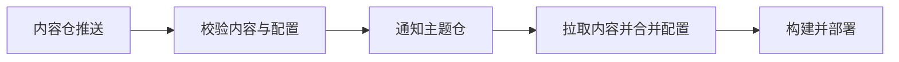

内容分离将博客拆分为两个 Git 仓库：

- **主题仓**：包含 Shirone 的源码、样式与构建脚本，可以直接跟随上游更新，也可以公开。
- **内容仓**：包含你的文章、说说、相册、数据与站点配置，可以设为私有。

构建时，主题仓先将内容仓的文件同步到自身的标准目录，再执行常规构建流程。因此主题代码不需要为内容分离做特殊改动。

## 两个仓库各放什么

| 内容 | 存放位置 |
| --- | --- |
| 文章、瞬间、系列、关于页文案 | 内容仓 `content/` |
| 站点标题、导航、侧栏、评论等配置 | 内容仓 `config/` |
| 项目、设备、技能、友链等结构化数据 | 内容仓 `data/` |
| 需要压缩优化的图片 | 内容仓 `assets/` |
| 原样发布的图片、相册、番剧封面 | 内容仓 `public/` |
| 主题组件、样式、构建脚本 | 主题仓 `src/`、`scripts/` |

完整的目录与映射关系见[初始化内容仓](/guide/content-separation/init-repo/#内容仓目录与映射)。各配置文件的写法见[配置覆盖](/guide/content-separation/config-overlay/)。

## 什么时候值得用双仓

| 你的情况 | 建议 |
| --- | --- |
| 第一次做博客，文章可以公开 | 先用单仓，配置最少 |
| 草稿、相册或联系方式不想公开 | 双仓，内容仓设为私有 |
| 打算长期使用，并持续跟随主题更新 | 双仓，升级时不会和自己的文章产生冲突 |
| 已经用单仓写了很多文章 | 可以随时迁出，见[初始化内容仓](/guide/content-separation/init-repo/) |

单仓与双仓并非一次性决定。运行 `pnpm content:eject` 会将现有文章和配置迁出到内容仓，并保留本地开发环境，迁出后仍可正常预览。

## 一次内容更新会经过哪些步骤

以“内容仓推送后自动部署”为例：

1. 在内容仓修改文章或 YAML，推送到 `main` 分支。
2. 内容仓的 GitHub Actions 调用主题仓的校验工作流，检查目录结构与配置字段。
3. 校验通过后发送 `content-updated` 事件，并携带本次提交的 SHA。
4. 主题仓按该 SHA 拉取内容，执行 `pnpm build`，将 `dist/` 发布到托管平台。

如果不使用 GitHub Actions，也可以让托管平台自行构建，由 Deploy Hook 触发。两种方式的差异见[部署钩子](/guide/content-separation/deploy-hooks/)。

## 本地写作时的数据流

本地开发无需每次提交推送到远端才能查看效果。设置 `CONTENT_DIR` 指向内容仓后，运行 `pnpm content:sync` 会将文件同步到主题仓的 `src/content/` 等目录；再运行 `pnpm dev` 即可预览。运行 `pnpm content:watch` 可以在保存文件时自动同步。

## 下一步

[初始化内容仓](/guide/content-separation/init-repo/)：使用一条命令迁出，或从官方模板新建。
