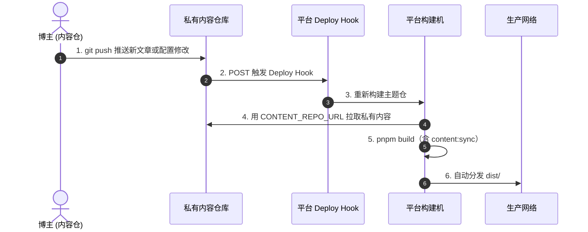

如果你把主题代码仓直接托管在 Cloudflare Pages、Vercel、腾讯云 EdgeOne 或 Netlify，并由平台构建机拉取内容打包，可以使用==部署钩子触发模式==。

内容仓推送后向托管平台的 Deploy Hook 发送一次 HTTP POST，平台重新拉取主题仓并构建。平台构建时会执行 `pnpm build`，而 `pnpm build` 已经包含 `content:sync`，所以**构建命令不要再加 `pnpm content:sync &&`**，重复同步只会增加构建时间。



`CONTENT_REPO_URL`、`CONTENT_REPO_REF` 和私有仓令牌的写法见[内容源配置与环境变量](/guide/content-separation/content-sources/)。

Deploy Hook 和 [跨仓 GitHub Actions 派发](/guide/content-separation/ci-dispatch/) 是两套互斥的触发方式。内容仓只配 `DISPATCH_TOKEN` 时由主题仓 Actions 构建；只配某个 `*_DEPLOY_HOOK` 时由平台构建。两种都配会让一次提交触发两次部署。

::: tip 先启用官方触发模板
不需要为每个平台各写一份触发工作流。内容仓的 `.github/workflows/trigger-build.yml.example` 已经包含 Cloudflare、Vercel、EdgeOne、Netlify 四个 Hook 步骤，未配置对应 Secret 时会自动跳过。

复制为 `trigger-build.yml` 后还要改两处占位符：`repository` 改成你的主题仓，`validate` job 的 `theme_repository` 也改成同一个仓库。然后在内容仓按需添加下表中的 Secret。

如果希望内容仓先跑校验，模板里的 `validate` job 会调用主题仓的 `content-validate.yml`。
:::

---

## 1. Cloudflare Pages 接入指南 <Badge text="推荐" type="tip" />

::: steps
1. **创建 Deploy Hook**

   - 登录 Cloudflare 控制台，进入 **Workers & Pages**；
   - 点击博客项目，前往 **Settings** -> **Builds & deployments**；
   - 滚动到 **Deploy hooks**，点击 **Add deploy hook**；
   - **Deploy hook name** 填 `content-push`，**Branch to build** 选择==main==；
   - 点击 **Add hook** 并复制完整 Webhook URL。

2. **配置构建与环境变量**

   进入 **Settings** -> **Environment variables**，添加：

   | 变量 | 值 |
   | --- | --- |
   | `NODE_VERSION` | `26` |
   | `PNPM_VERSION` | `11.28.2` |
   | `GIT_TERMINAL_PROMPT` | `0` |
   | `CONTENT_REPO_URL` | `https://x-access-token:<TOKEN>@github.com/<OWNER>/<CONTENT_REPO>.git` |

   构建命令填 `pnpm build`，输出目录填 `dist`。双仓模式建议再设置 `CONTENT_REPO_REF=main`；需要按固定分支/标签构建时改这个值。

   > [!WARNING]
   > 必须创建的是 **Pages** 项目，不是 Workers。选成 Worker 后构建日志会出现 `__dirname is not defined`，这是运行环境不兼容，不是代码问题。

3. **在内容仓配置 Secret**

   进入私有内容仓 **Settings** -> **Secrets and variables** -> **Actions**，添加：

   - **Name**：`CLOUDFLARE_DEPLOY_HOOK`
   - **Secret**：粘贴第 1 步的 URL

4. **启用触发工作流**

   使用内容仓的 `trigger-build.yml.example`，或单独建一个调用 Hook 的工作流：

   ```yaml title=".github/workflows/trigger-cloudflare.yml"
   name: Trigger Cloudflare Pages Build

   on:
     push:
       branches: [main]
     workflow_dispatch:

   jobs:
     deploy-hook:
       runs-on: ubuntu-latest
       steps:
         - name: Call Cloudflare Deploy Hook
           env:
             CLOUDFLARE_DEPLOY_HOOK: ${{ secrets.CLOUDFLARE_DEPLOY_HOOK }}
           if: ${{ env.CLOUDFLARE_DEPLOY_HOOK != '' }}
           run: |
             curl --fail-with-body --silent --show-error \
               --retry 3 --retry-delay 2 --max-time 30 \
               --request POST "$CLOUDFLARE_DEPLOY_HOOK"
   ```
:::

---

## 2. Vercel 接入指南 <Badge text="主流" type="info" />

::: steps
1. **创建 Deploy Hook**

   - 登录 Vercel，进入博客项目；
   - **Settings** -> **Git** -> **Deploy Hooks**；
   - **Hook Name** 填 `content-push`，**Branch** 填 `main`；
   - 点击 **Create Hook** 并复制 URL。

2. **配置项目与环境变量**

   在 **Settings** -> **General** -> **Node.js Version** 选择 `26.x`。Vercel 不读取 `NODE_VERSION` 环境变量。

   环境变量可以在导入项目时展开 **Environment Variables** 直接填写，也可以之后在 **Deployments** -> **Environments** 添加：

   | 变量 | 值 |
   | --- | --- |
   | `CONTENT_REPO_URL` | `https://x-access-token:<TOKEN>@github.com/<OWNER>/<CONTENT_REPO>.git` |
   | `CONTENT_REPO_REF` | `main`（可选） |
   | `GIT_TERMINAL_PROMPT` | `0` |

   构建命令保持默认的 `pnpm build`，输出目录 `dist`。

3. **在内容仓配置 Secret**

   添加 `VERCEL_DEPLOY_HOOK`，值为第 1 步的 URL。

4. **启用触发工作流**

   使用内容仓 `trigger-build.yml.example` 内置的 Vercel Hook 步骤即可；单独写时把上面的 `curl` 命令换成：

   ```bash
   curl --fail-with-body --silent --show-error \
     --retry 3 --retry-delay 2 --max-time 30 \
     --request POST "$VERCEL_DEPLOY_HOOK"
   ```
:::

---

## 3. 腾讯云 EdgeOne 接入指南 <Badge text="国内加速" type="tip" />

::: steps
1. **创建部署触发器**

   - 登录腾讯云 EdgeOne Pages 控制台；
   - 项目设置 -> **构建与部署** -> **部署触发器 (Deploy Hook)**；
   - 新增钩子，分支绑定 `main`，复制触发 URL。

2. **配置构建与环境变量**

   | 配置项 | 值 |
   | --- | --- |
   | Node.js 版本 | `24` |
   | 构建命令 | `npm i -g pnpm@11.28.2 && pnpm build` |
   | 输出目录 | `dist` |
   | `CONTENT_REPO_URL` | `https://x-access-token:<TOKEN>@github.com/<OWNER>/<CONTENT_REPO>.git` |
   | `CONTENT_REPO_REF` | `main`（可选） |
   | `GIT_TERMINAL_PROMPT` | `0` |

   EdgeOne 当前最高可选 Node.js 24，Node.js 24 可以正常构建 Shirone。若构建镜像没有预装匹配的 pnpm，就在构建命令里显式安装；EdgeOne 没有文档化的 `PNPM_VERSION` 变量，不要照搬 Cloudflare 的写法。

3. **在内容仓配置 Secret**

   添加 `EDGEONE_DEPLOY_HOOK`，值为部署钩子 URL。

4. **启用触发工作流**

   使用内容仓 `trigger-build.yml.example` 内置的 EdgeOne Hook 步骤。
:::

---

## 4. Netlify 接入指南

::: steps
1. **创建 Build Hook**

   - 进入项目 **Site configuration** -> **Build & deploy** -> **Continuous deployment**；
   - 找到 **Build hooks**，点击 **Add build hook**；
   - 填名称、分支 `main`，保存并复制 URL。

2. **配置构建与环境变量**

   在 **Site configuration** -> **Environment variables** 添加：

   | 变量 | 值 |
   | --- | --- |
   | `NODE_VERSION` | `26` |
   | `GIT_TERMINAL_PROMPT` | `0` |
   | `CONTENT_REPO_URL` | `https://x-access-token:<TOKEN>@github.com/<OWNER>/<CONTENT_REPO>.git` |

   构建命令 `pnpm build`，发布目录 `dist`。Netlify 通过 `package.json` 的 `packageManager` 或 mise 选择 pnpm；若日志里 pnpm 版本仍不匹配，在构建命令前加 `npm i -g pnpm@11.28.2 &&`。

3. **在内容仓配置 Secret**

   添加 `NETLIFY_DEPLOY_HOOK`，值为 Build Hook URL。

4. **启用触发工作流**

   使用内容仓 `trigger-build.yml.example` 内置的 Netlify Hook 步骤。
:::

---

## 关于版本与触发精度

- Deploy Hook 只负责“让平台重新构建”，平台通常拉取的是内容仓分支的最新 HEAD，不保证与你刚推送的那个 commit 完全一致。连续快速推送时，如果需要精确按 SHA 构建，请改用 [跨仓 Actions 派发](/guide/content-separation/ci-dispatch/)。
- 平台构建机支持的 Node 版本不同：Cloudflare / Vercel / Netlify 用 26；EdgeOne 用 24。不要在所有平台统一写 26。
- 私有内容仓必须设置 `CONTENT_REPO_URL` 和 `GIT_TERMINAL_PROMPT=0`，否则构建机可能卡在交互式账号密码提示。
- `pnpm build` 已包含 `content:sync`，构建命令保持 `pnpm build` 即可。

---

## 密钥名称对照速查表

| 托管平台 | GitHub Secret 变量名（严格匹配） | 触发机制说明 |
| :--- | :--- | :--- |
| **跨仓联动构建（推荐）** | `DISPATCH_TOKEN` <Badge text="推荐" type="tip" /> | 通知主题代码仓通过 GitHub Actions 拉取、编译与发布 |
| **Cloudflare Pages** | `CLOUDFLARE_DEPLOY_HOOK` <Badge text="边缘" type="info" /> | POST Deploy Hook 触发重新构建 |
| **Vercel** | `VERCEL_DEPLOY_HOOK` <Badge text="全球" type="info" /> | POST Deploy Hook 触发重新部署 |
| **腾讯云 EdgeOne** | `EDGEONE_DEPLOY_HOOK` <Badge text="国内" type="tip" /> | POST 部署钩子触发构建发布 |
| **Netlify** | `NETLIFY_DEPLOY_HOOK` <Badge text="通用" type="info" /> | POST Build Hook 触发重新编译 |

---

## 下一步

- 前往 [常见问题与排错](/guide/content-separation/faq/)：查阅权限排查、字段覆盖与构建报错解决方案
