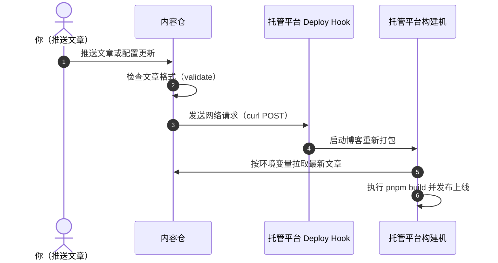

部署钩子（Deploy Hook）是托管平台（如 Cloudflare Pages、Vercel、EdgeOne、Netlify）提供的一个专用网址。

在双仓分离模式下，你的主题代码存放在代码仓，文章存放在内容仓。当你写完文章推送到内容仓后，内容仓的自动化脚本会向这个网址发送一次通知。托管平台收到通知后，就会自动启动构建，拉取主题代码与最新文章，打包并发布上线。



## 与 Actions 跨仓构建二选一

在内容分离架构中，让博客上线主要有两种自动化方案。你可以根据自己的使用习惯二选一：

| 对比项 | 部署钩子（本篇方案） | Actions 跨仓构建 |
| --- | --- | --- |
| 谁负责打包 | 托管平台自己的构建服务器 | GitHub Actions 虚拟机 |
| 内容仓脚本的作用 | 检查文章格式，向钩子网址发送通知 | 检查文章格式，通知主题仓启动完整流水线 |
| 平台侧设置 | 开启平台自动构建，保留 `pnpm build` | 关闭平台自动构建，仅接收打包好的 `dist/` |
| 内容仓库配置 | 在平台后台添加内容仓的 Git 地址 | 在 GitHub 密钥中配置跨仓访问令牌 |
| 适合人群 | 希望配置尽量简单、直接使用平台构建的用户 | 需要精准按某次提交打包、或国内自建服务器部署的用户 |

::: warning 两套方案不可同时使用
不要针对同一个托管平台同时启用 Actions 跨仓构建和部署钩子。

两边同时配置会导致每次推送文章都触发两次构建，线上网页可能会相互覆盖。若平台开启了自身构建，而 Actions 同时上传静态文件，平台的构建日志还会报出构建冲突错误。
:::

## 详细配置步骤

整个配置流程分为五个步骤：

::: steps

1. **在托管平台获取部署钩子网址**

   进入你所使用的托管平台控制台，为博客项目创建一个部署钩子（Deploy Hook），并复制生成的 Webhook 网址：

   :::: tabs
   @tab Cloudflare Pages
   进入项目的 **Settings** -> **Builds & deployments**，向下滚动找到 **Deploy hooks** 分组：

   - 点击 **Add hook** 按钮；
   - **Hook name** 填写名称（例如 `content-update`）；
   - **Branch** 选择博客的主分支 `main`；
   - 点击 **Add hook** 保存，随后复制弹出的 Webhook URL。

   

   

   @tab Vercel
   进入项目的 **Settings** -> **Git** 页面，向下滚动找到 **Deploy Hooks** 分组：

   - **Hook Name** 填写名称（例如 `content-update`）；
   - **Branch** 填写主分支 `main`；
   - 点击 **Create Hook** 按钮；
   - 复制生成的触发网址（格式类似于 `https://api.vercel.com/v1/integrations/deploy/prj_...`）。

   @tab EdgeOne Pages
   进入项目的 **项目设置** -> **构建与部署**，找到 **部署触发器** 分组：

   - 点击 **新增触发器**；
   - 触发分支选择 `main`；
   - 保存后，复制生成的触发 URL 地址。

   

   @tab Netlify
   进入项目的 **Site configuration** -> **Build & deploy** -> **Continuous deployment**，找到 **Build hooks** 分组：

   - 点击 **Add build hook** 按钮；
   - **Title** 填写名称（例如 `content-update`）；
   - **Branch to build** 选择 `main`；
   - 点击 **Save**，复制生成的 Webhook 网址。
   ::::

2. **在托管平台添加内容仓环境变量**

   托管平台的构建机默认只关联了主题代码仓库。在执行打包命令时，它需要知道你的文章存放在哪里，因此必须在平台后台补充内容仓库的环境变量。

   进入托管平台的项目环境变量（Environment Variables）设置页面，添加以下变量：

   | 变量名 | 必填 | 说明与推荐值 |
   | --- | --- | --- |
   | `CONTENT_REPO_URL` | 是 | 内容仓库的 Git 地址（格式见下方说明） |
   | `CONTENT_REPO_REF` | 否 | 内容仓库的分支，通常为 `main` |
   | `GIT_TERMINAL_PROMPT` | 是 | 固定填 `0`，防止拉取私有仓库时因密码等待卡住构建 |

   关于 `CONTENT_REPO_URL` 的填写规则：

   - **公开内容仓库**：直接填仓库的 HTTPS 地址即可：
     ```text
     https://github.com/你的用户名/你的内容仓库名.git
     ```
   - **私有内容仓库**：需要带上具有读取权限的 Personal Access Token（访问令牌）：
     ```text
     https://x-access-token:<你的TOKEN>@github.com/你的用户名/你的内容仓库名.git
     ```
     访问令牌的生成方法请参考[申请个人访问令牌](/guide/content-separation/pat/)，权限勾选 `Contents: Read` 即可。

   **核对平台的 Node.js 版本与构建参数**：

   - Cloudflare Pages、Vercel 与 Netlify 建议使用 Node.js 26；EdgeOne 当前支持 Node.js 24，均可正常完成构建；
   - 构建命令保持为 `pnpm build`，输出目录保持为 `dist`。`pnpm build` 内部已经自动包含了文章同步命令，不需要手动修改。

3. **将钩子网址存入内容仓的 GitHub 密钥**

   打开你的**内容仓库**（存放文章的仓库），把第一步复制到的钩子网址保存为 GitHub Actions 密钥，避免公开泄露：

   1. 进入内容仓库的 **Settings** -> **Secrets and variables** -> **Actions**；
   2. 点击 **New repository secret** 按钮；
   3. 根据你使用的平台，填入对应的密钥名称（Name），并在 Secret 中粘贴第一步获取的完整网址；
   4. 点击 **Add secret** 保存。

   

   

   

   不同平台对应的密钥名称如下（必须完全一致）：

   | 托管平台 | 密钥名称（Name） |
   | --- | --- |
   | Cloudflare Pages | `CLOUDFLARE_DEPLOY_HOOK` |
   | Vercel | `VERCEL_DEPLOY_HOOK` |
   | EdgeOne Pages | `EDGEONE_DEPLOY_HOOK` |
   | Netlify | `NETLIFY_DEPLOY_HOOK` |

4. **在内容仓启用触发工作流**

   在内容仓库根目录下，把预置的示例工作流文件重命名为正式工作流：

   ```bash
   cp .github/workflows/trigger-build.yml.example .github/workflows/trigger-build.yml
   ```

   这个工作流在检测到文章有变动时，会向你配置的部署钩子发送网络请求：

   ```yaml title=".github/workflows/trigger-build.yml（部署钩子部分）"
   jobs:
     # 第一步：先检查文章与配置文件的语法和格式
     validate:
       uses: LyraVoid/Shirone/.github/workflows/content-validate.yml@main
       with:
         theme_repository: LyraVoid/Shirone # 填写你的主题代码仓
         theme_ref: main

     # 第二步：检查通过后，触发托管平台的部署钩子
     dispatch:
       needs: validate
       runs-on: ubuntu-latest
       timeout-minutes: 5
       steps:
         # 触发 Cloudflare Pages（未配置对应 Secret 时自动跳过）
         - name: Trigger Cloudflare Pages deploy hook
           env:
             CLOUDFLARE_DEPLOY_HOOK: ${{ secrets.CLOUDFLARE_DEPLOY_HOOK }}
           if: ${{ env.CLOUDFLARE_DEPLOY_HOOK != '' }}
           run: |
             curl -s -S -X POST "${{ env.CLOUDFLARE_DEPLOY_HOOK }}"

         # 触发 Vercel（未配置对应 Secret 时自动跳过）
         - name: Trigger Vercel deploy hook
           env:
             VERCEL_DEPLOY_HOOK: ${{ secrets.VERCEL_DEPLOY_HOOK }}
           if: ${{ env.VERCEL_DEPLOY_HOOK != '' }}
           run: |
             curl -s -S -X POST "${{ env.VERCEL_DEPLOY_HOOK }}"

         # 触发 EdgeOne（未配置对应 Secret 时自动跳过）
         - name: Trigger EdgeOne deploy hook
           env:
             EDGEONE_DEPLOY_HOOK: ${{ secrets.EDGEONE_DEPLOY_HOOK }}
           if: ${{ env.EDGEONE_DEPLOY_HOOK != '' }}
           run: |
             curl -s -S -X POST "${{ env.EDGEONE_DEPLOY_HOOK }}"

         # 触发 Netlify（未配置对应 Secret 时自动跳过）
         - name: Trigger Netlify deploy hook
           env:
             NETLIFY_DEPLOY_HOOK: ${{ secrets.NETLIFY_DEPLOY_HOOK }}
           if: ${{ env.NETLIFY_DEPLOY_HOOK != '' }}
           run: |
             curl -s -S -X POST "${{ env.NETLIFY_DEPLOY_HOOK }}"
   ```

   工作流针对四个平台都设置了判断条件（`if`）。你没有配置密钥的平台会自动跳过，只有配置了密钥的平台才会执行触发，不需要专门去删除其他平台的代码。

5. **推送更新并验证效果**

   配置完成后，你可以进行一次推送测试：

   1. 在内容仓库中修改任意一篇文章，或者新增一篇测试文章；
   2. 执行 `git push` 推送到内容仓的 `main` 分支；
   3. 进入内容仓库的 **Actions** 标签页，查看 `Trigger Theme Build` 工作流是否顺利跑完并显示绿色勾号；
   4. 进入你的托管平台控制台，在部署历史（Deployments）中查看是否已经收到了触发请求，并且正在自动打包；
   5. 等待构建完成后，刷新博客网页，确认新发布的文章已经展示在线上。

:::

## 常见问题排查

::: collapse
- 内容仓 Actions 运行成功，但托管平台没有触发打包？

  请检查内容仓库中的密钥名称（Secret Name）是否与上面表格中的拼写完全一致，大小写不能写错；同时检查保存的网址是否完整，有没有遗漏末尾字符。

- 托管平台构建日志报错拉取内容失败或认证失败？

  如果你的内容仓库是私有仓库，请检查托管平台后台配置的 `CONTENT_REPO_URL` 变量是否包含了访问令牌，并确认该令牌是否已经过期，或者是否未勾选 `Contents: Read` 读取权限。

- 短时间内多次连续推送文章会怎样？

  内容仓工作流配置了并发控制（`concurrency`），如果在短时间内连续推送多次，旧的未完成触发会自动取消，仅保留最新一次推送，避免多个任务同时请求。
  
  部署钩子会促使托管平台重新触发一次构建，平台在拉取内容仓时默认读取该分支最新的提交。如果你需要每次构建都必须精确对应某个历史版本，建议使用[跨仓自动构建](/guide/content-separation/ci-dispatch/)方案。
:::

## 下一步

- [申请个人访问令牌](/guide/content-separation/pat/)：查看如何为私有仓库创建具有读取权限的令牌
- [跨仓自动构建](/guide/content-separation/ci-dispatch/)：了解基于 GitHub Actions 的另一种自动部署方案
- [自动打包与部署工作流](/guide/development/workflows/)：深入了解工作流各配置项的具体作用
- [常见问题与排查](/guide/content-separation/faq/)：查看双仓模式下的常见报错与解决办法
