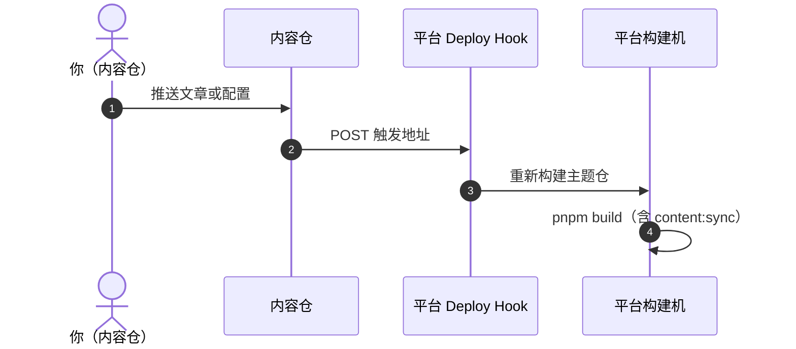

部署钩子（Deploy Hook）是托管平台提供的 HTTP 触发地址。内容仓推送更新后，向该地址发送一次 POST 请求，平台便会重新拉取主题仓并执行构建。



## 与 Actions 派发只能二选一

| 对比项 | Actions 派发 | 部署钩子 |
| --- | --- | --- |
| 谁执行构建 | 主题仓的 GitHub Actions | 托管平台构建机 |
| 平台侧设置 | 关闭平台构建，仅接收静态 `dist/` | 保留 `pnpm build` 构建命令 |
| 内容源配置 | `CONTENT_DIR` 指向检出的 `.content-src/` | `CONTENT_REPO_URL` 远程拉取内容仓 |
| 构建精度 | 精确按触发提交的 commit SHA 构建 | 拉取平台分支最新 HEAD 提交 |

::: warning
两套方案不可同时配置，否则单次推送会引发两次部署，导致线上产物相互覆盖。若平台仍保留构建命令，而 Actions 同时上传静态 `dist/`，平台构建日志将报错 `Error: Command "pnpm build" exited with 1`。
:::

## 四个平台速查

内容仓的 `trigger-build.yml.example` 预设了四个平台的触发步骤。若未配置对应 Secret，步骤会自动跳过，无需为每个平台单独编写工作流。

| 平台 | 创建钩子的位置 | 内容仓 Secret | 详细配置说明 |
| --- | --- | --- | --- |
| Cloudflare Pages | Settings -> Builds & deployments -> Deploy hooks | `CLOUDFLARE_DEPLOY_HOOK` | [Cloudflare Pages](/guide/deploy/cloudflare/) |
| Vercel | Settings -> Git -> Deploy Hooks | `VERCEL_DEPLOY_HOOK` | [Vercel](/guide/deploy/vercel/) |
| EdgeOne Pages | 项目设置 -> 构建与部署 -> 部署触发器 | `EDGEONE_DEPLOY_HOOK` | [EdgeOne Pages](/guide/deploy/edgeone/) |
| Netlify | Site configuration -> Build & deploy -> Build hooks | `NETLIFY_DEPLOY_HOOK` | [Netlify](/guide/deploy/netlify/) |

在平台创建钩子时，分支统一选择 `main`。复制生成的 URL，填入内容仓对应的 Secret 变量中。

## 平台侧必须配置的变量

采用部署钩子时，双仓模式需在平台控制台配置以下环境变量：

```text
CONTENT_REPO_URL=https://x-access-token:<TOKEN>@github.com/OWNER/REPO.git
CONTENT_REPO_REF=main
GIT_TERMINAL_PROMPT=0
```

`GIT_TERMINAL_PROMPT=0` 用于避免构建机在拉取私有仓时挂起等待交互式账号输入。构建命令保持为 `pnpm build`，输出目录为 `dist`；`pnpm build` 已经包含 `content:sync`，切勿重复添加。

平台的 Node.js 版本需按要求指定：Cloudflare、Vercel 与 Netlify 选用 26；EdgeOne 目前最高支持 24，Node 24 可以正常完成构建。

## 触发精度

部署钩子会促使托管平台重新触发构建，但平台通常拉取内容仓分支的最新 HEAD 提交，不保证与刚推送的 commit 完全一致。若存在快速连续推送需求、或需要精确复现某次提交的历史构建，建议采用[跨仓自动构建](/guide/content-separation/ci-dispatch/)。

## 下一步

- [自动打包与部署工作流](/guide/development/workflows/)：了解内容仓库 trigger-build 工作流如何调用部署钩子
- [常见问题](/guide/content-separation/faq/)：令牌权限、身份鉴权失败与配置未生效排查。
