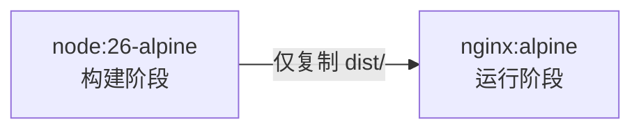

本文介绍基于 Docker 的容器化部署方案。构建位置选择与平台构建命令的开关说明，详见[部署总览](/guide/deploy/overview/)。

Docker 将构建与运行环境封装在镜像内部，可在任意服务器上一致运行，不依赖宿主机是否安装匹配版本的 Node.js。

## 镜像结构

构建采用多阶段镜像构建（Multi-stage Build）：



- 构建阶段：基于 Node 26 与 pnpm 运行完整的 `pnpm build` 命令；
- 运行阶段：仅保留轻量级 Nginx 与编译好的静态文件，镜像体积小于 50 MB，无额外 Node 运行时开销。

## 准备三个文件

### .dockerignore

```text title=".dockerignore"
.git
node_modules
dist
.astro
.vscode
.github
docs
tests
public/assets/moments/thumbnails
```

切勿将 `scripts/` 加入排除名单。`pnpm build` 在执行期间会调用 `scripts/content/sync.mjs` 及字体检查脚本，缺少此目录会导致镜像构建直接失败。

### Dockerfile

```dockerfile title="Dockerfile"
# 构建阶段
FROM node:26-alpine AS builder

WORKDIR /app

# Node.js 26 不再内置 corepack，直接安装指定版本
RUN npm install -g pnpm@11.28.2

# 先复制依赖清单以复用镜像层缓存
COPY package.json pnpm-lock.yaml .npmrc ./
RUN pnpm install --frozen-lockfile

# 再复制源码并执行构建
COPY . .
RUN pnpm build

# 运行阶段
FROM nginx:alpine

COPY --from=builder /app/dist /usr/share/nginx/html
COPY nginx.conf /etc/nginx/conf.d/default.conf

EXPOSE 80

CMD ["nginx", "-g", "daemon off;"]
```

将依赖清单与项目源码拆分为两次 `COPY` 操作，使得仅在依赖变动时重新安装包，日常的文章或页面微调可直接命中 Docker 构建缓存。

### nginx.conf

```nginx title="nginx.conf"
server {
    listen 80;
    server_name _;
    root /usr/share/nginx/html;
    index index.html;

    gzip on;
    gzip_types text/css application/javascript application/json image/svg+xml;
    gzip_min_length 1024;

    location /assets/ {
        expires 1y;
        add_header Cache-Control "public, immutable";
    }

    location /pagefind/ {
        expires 24h;
    }

    location / {
        try_files $uri $uri/ =404;
    }
}
```

::: warning
构建阶段需要运行字体子集化与 Pagefind 全文索引，内存峰值较高。建议为 Docker 容器分配至少 4 GB 运行内存。
:::

## 双仓模式

在镜像构建过程中，需要将内容源信息传入 `pnpm build`。切勿将包含令牌的仓库地址直接写在 `ARG` 或 `ENV` 指令中，避免凭据泄漏至镜像历史层。推荐使用 Docker BuildKit Secret：

```dockerfile
# syntax=docker/dockerfile:1
RUN --mount=type=secret,id=content_repo_url \
    CONTENT_REPO_URL="$(cat /run/secrets/content_repo_url)" pnpm build
```

```bash
echo "https://x-access-token:<TOKEN>@github.com/<OWNER>/<CONTENT_REPO>.git" > .content-repo-url
docker build --secret id=content_repo_url,src=.content-repo-url -t shirone-blog .
rm .content-repo-url
```

亦可选择在 CI 中预先编译输出 `dist/`，随后仅通过纯 Nginx 基础镜像进行打包与分发。

## 构建与运行

```bash
docker build -t shirone-blog .

docker run -d --name shirone-blog \
  -p 8080:80 \
  --restart unless-stopped \
  shirone-blog
```

访问 `http://localhost:8080` 验证页面展示与全文搜索功能。

### Docker Compose

```yaml title="docker-compose.yml"
services:
  shirone:
    build: .
    image: shirone-blog:latest
    container_name: shirone-blog
    ports:
      - "8080:80"
    restart: unless-stopped
```

```bash
docker compose up -d
docker compose up -d --build   # 内容更新后重新构建并启动
```

## 更新与回滚

```bash
git pull
docker compose up -d --build
```

历史镜像依然保留在本地磁盘。若需紧急回滚，可为旧镜像设置标签并更新 Compose 配置文件中的 `image`：

```bash
docker images                      # 查询历史镜像 ID
docker tag <旧镜像ID> shirone-blog:rollback
docker compose up -d               # 确保 image 已指向 shirone-blog:rollback
```

## 反向代理与 HTTPS

生产环境中通常在宿主机通过 Nginx 或 Caddy 对容器端口进行反向代理：

```nginx title="宿主机 /etc/nginx/conf.d/blog.conf"
server {
    listen 443 ssl;
    server_name your-domain.com;

    location / {
        proxy_pass http://127.0.0.1:8080;
        proxy_set_header Host $host;
        proxy_set_header X-Real-IP $remote_addr;
    }
}
```

SSL 证书可借助 certbot 进行自动化签发与续期，步骤详见[服务器部署](/guide/deploy/server/#第四步-https)。

## 常见问题

::: collapse
- 构建报错：`only-allow pnpm`

  使用了 npm 安装依赖，或未锁定安装指定版本的 pnpm。请严格遵循 Dockerfile 中的书写规则：先执行 `npm install -g pnpm@11.28.2`，再执行 `pnpm install --frozen-lockfile`。

- 构建阶段内存不足（OOM）

  确保为 Docker 守护进程分配了至少 4 GB 内存，或在构建时添加参数 `docker build --memory=4g`。

- 全文搜索功能不可用

  检查 Dockerfile 中的构建指令是否被改写为了单命令 `astro build`。直接调用 `astro build` 会跳过 Pagefind 索引生成。需确保生成产物中包含 `/pagefind/` 目录。

- 是否建议在容器内部署评论服务

  不建议。评论系统（Twikoo、Waline 等）建议作为独立服务容器部署，由宿主机 Nginx 按照路径分发反向代理，保持博客静态容器的纯粹无状态特性。
:::

## 下一步

- [服务器部署](/guide/deploy/server/)：Nginx 配置、证书管理与自动发布
- [部署总览](/guide/deploy/overview/)：对比其他托管平台
