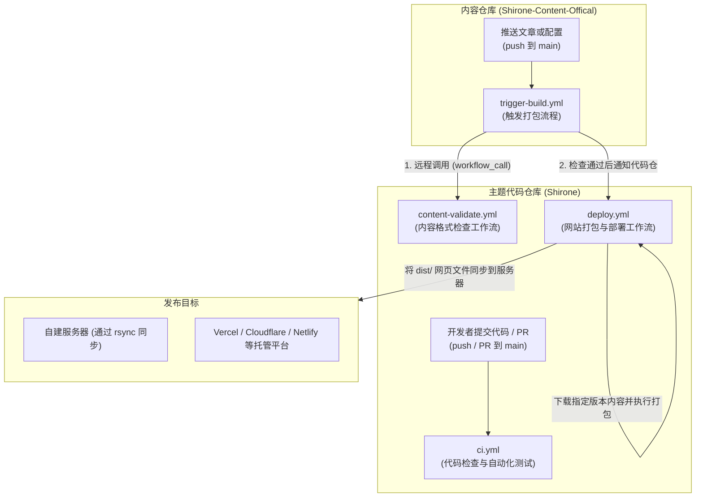

Shirone 提供了 4 个核心 GitHub Actions 工作流，分别位于主题代码仓库与官方内容仓库中。本文结合每个工作流的 YAML 源代码，逐行解析其触发条件、检查逻辑与构建部署流程。



---

## 工作流清单速查

| 仓库 | 文件路径 | 触发条件 | 主要用途 |
| --- | --- | --- | --- |
| **主题代码仓** | `.github/workflows/ci.yml` | 提交代码到 `main` 分支、发起 PR、手动触发 | **代码检查与自动化测试**：检查代码书写规范、运行框架诊断以及测试页面交互与视觉样式。 |
| **主题代码仓** | `.github/workflows/content-validate.yml` | 被外部仓库调用（`workflow_call`） | **内容格式检查**：供内容仓库调用，检查目录结构、YAML 配置文件以及文章头部信息是否合规。 |
| **主题代码仓** | `.github/workflows/deploy.yml.example` | 代码更新、收到内容仓通知、定时计划、手动触发 | **网站打包与发布**：合并内容并执行打包，将生成的 `dist/` 网页文件同步到服务器或托管平台。 |
| **内容仓库** | `.github/workflows/trigger-build.yml.example` | 修改文章或配置后推送、手动触发 | **内容更新触发器**：先调用主题仓工作流检查内容格式，通过后再向主题仓发送打包通知。 |

---

## 1. 主题代码检查工作流 (`ci.yml`)

该工作流位于主题代码仓库的 `.github/workflows/ci.yml`，每次提交代码或发起 Pull Request 时自动运行，用于确保提交的代码符合格式规范且不会导致功能异常。

### 触发条件与并发控制

```yaml title=".github/workflows/ci.yml"
name: Shirone CI

on:
  push:
    branches: [main]
  pull_request:
    branches: [main]
  workflow_dispatch:

concurrency:
  group: ${{ github.workflow }}-${{ github.event.pull_request.number || github.ref }}
  cancel-in-progress: true

permissions:
  contents: read
```

- `on`: 监听向 `main` 分支的推送和 Pull Request，也支持在 GitHub 网页手动点击运行；
- `concurrency`: 当同一个分支或 PR 连续推送新的代码时，自动取消上一次未完成的检查，避免浪费运行时间；
- `permissions: contents: read`: 权限控制，该工作流只需要读取仓库代码的权限。

### 核心任务代码与解析

#### 任务一：分析文件变动 (`changes`)

并不是所有提交都需要运行耗时较长的浏览器页面测试。该任务通过脚本分析改动了哪些文件：

```yaml title=".github/workflows/ci.yml"
  changes:
    name: Detect changed paths
    runs-on: ubuntu-24.04
    timeout-minutes: 5
    outputs:
      comments: ${{ steps.filter.outputs.comments }}
      styles: ${{ steps.filter.outputs.styles }}
    steps:
      - name: Checkout history for path detection
        uses: actions/checkout@v7
        with:
          fetch-depth: 0

      - name: Classify changed paths
        id: filter
        shell: bash
        run: |
          scripts/ci/classify-browser-suites.sh "$base" "$head" "$GITHUB_OUTPUT"
```

- 如果修改了评论系统相关的文件，输出 `comments=true`，后续才会运行评论功能测试；
- 如果修改了字体、配色或样式文件，输出 `styles=true`，后续才会运行样式测试；
- 如果修改的是其他文件，后续对应的页面测试会自动跳过。

#### 任务二：代码格式与规范检查 (`quality`)

```yaml title=".github/workflows/ci.yml"
  quality:
    name: Code quality
    runs-on: ubuntu-24.04
    steps:
      - uses: actions/checkout@v7
      - uses: pnpm/action-setup@v6
      - uses: actions/setup-node@v7
        with:
          node-version: 26.13.0
          cache: pnpm
      - run: pnpm install --frozen-lockfile
      - name: Run Biome
        continue-on-error: true
        run: pnpm exec biome ci ./src --reporter=github
```

- 使用 Node.js 26 和 pnpm 安装依赖；
- 运行 Biome 工具扫描 `src/` 目录中的代码，如有格式错误或书写不规范的地方，会直接标注在 GitHub 页面上。

#### 任务三：框架类型检查与单元测试 (`checks`)

```yaml title=".github/workflows/ci.yml"
  checks:
    name: Diagnostics and tests
    runs-on: ubuntu-24.04
    steps:
      - uses: actions/checkout@v7
      - uses: pnpm/action-setup@v6
      - uses: actions/setup-node@v7
        with:
          node-version: 26.13.0
          cache: pnpm
      - run: pnpm install --frozen-lockfile

      - name: Check Astro diagnostics
        run: pnpm exec astro check

      - name: Check Svelte diagnostics
        run: pnpm exec svelte-check --tsconfig ./tsconfig.json

      - name: Validate atom manifest
        run: pnpm check:manifest

      - name: Run unit tests
        run: node --test "tests/**/*.test.mjs"
```

- `astro check`: 检查 Astro 模板文件语法与 TypeScript 类型定义；
- `svelte-check`: 检查 Svelte 组件的语法与组件属性；
- `pnpm check:manifest`: 检查内置原子组件清单是否完整；
- `node --test`: 运行系统自带的轻量级单元测试。

#### 任务四：自动化页面测试与样式测试 (`comment-tests` 与 `styles`)

```yaml title=".github/workflows/ci.yml"
  comment-tests:
    name: Comment regression fixtures
    needs: changes
    if: needs.changes.outputs.comments == 'true'
    strategy:
      fail-fast: false
      matrix:
        mode: [disabled, waline, twikoo, no-toc]
    steps:
      - uses: actions/checkout@v7
      - uses: pnpm/action-setup@v6
      - uses: actions/setup-node@v7
      - run: pnpm install --frozen-lockfile
      - name: Run comment tests
        run: pnpm exec playwright test tests/site/comments.spec.ts
```

- 通过 `needs: changes` 接收文件改动分析结果；
- 使用矩阵（`matrix`）分别在“未开启评论”、“开启 Waline”、“开启 Twikoo”、“隐藏文章目录”四种不同配置下，调用 Playwright 自动化测试浏览器打开网页、点击页面跳转与评论加载功能。

---

## 2. 可复用内容格式检查工作流 (`content-validate.yml`)

该工作流位于主题代码仓库的 `.github/workflows/content-validate.yml`。

它采用 GitHub Actions 的 `workflow_call` 机制，专门提供给外部的内容仓库调用。在作者向内容仓库提交文章时，该工作流能够提前检查文章格式，避免在发布时才发现错误。

### 源代码展示与解析

```yaml title=".github/workflows/content-validate.yml"
name: Validate content

on:
  workflow_call:
    inputs:
      theme_repository:
        description: "主题（代码）仓，形如 OWNER/REPO"
        type: string
        required: true
      theme_ref:
        description: "主题仓的分支或版本"
        type: string
        required: false
        default: main
    secrets:
      theme_token:
        description: "主题仓若为私有时用于拉取代码的 token"
        required: false

jobs:
  validate:
    name: Schema and structure
    runs-on: ubuntu-latest
    steps:
      # 1. 下载调用方（内容仓库）的文件到 content 文件夹
      - name: Checkout content
        uses: actions/checkout@v4
        with:
          path: content

      # 2. 下载主题代码仓库的文件到 theme 文件夹
      - name: Checkout theme
        uses: actions/checkout@v4
        with:
          repository: ${{ inputs.theme_repository }}
          ref: ${{ inputs.theme_ref }}
          path: theme
          token: ${{ secrets.theme_token || github.token }}

      # 3. 读取主题 package.json 中指定的 pnpm 版本并完成安装
      - name: Set up pnpm
        uses: pnpm/action-setup@v4
        with:
          package_json_file: theme/package.json
          run_install: false

      - name: Set up Node.js
        uses: actions/setup-node@v4
        with:
          node-version: 26.13.0
          cache: pnpm
          cache-dependency-path: theme/pnpm-lock.yaml

      - name: Install dependencies
        working-directory: theme
        run: pnpm install --frozen-lockfile --prefer-offline

      # 4. 第一阶段：检查目录规范与 config 目录下的 yaml 配置文件格式
      - name: Validate content structure and config
        working-directory: theme
        env:
          CONTENT_DIR: ${{ github.workspace }}/content
        run: pnpm content:validate

      # 5. 第二阶段：检查每篇 Markdown 文章头部的 Frontmatter 字段
      - name: Validate frontmatter schemas
        working-directory: theme
        env:
          CONTENT_DIR: ${{ github.workspace }}/content
        run: |
          set -euo pipefail
          pnpm content:sync
          pnpm exec astro sync

      # 6. 生成结果摘要报告
      - name: Summarize
        if: always()
        working-directory: theme
        run: |
          {
            echo "### Content validation"
            echo "- 主题仓：\`${{ inputs.theme_repository }}@${{ inputs.theme_ref }}\`"
          } >> "$GITHUB_STEP_SUMMARY"
```

### 关键步骤说明

- **双仓库下载**：工作流同时将内容仓库下载至 `content/`，将主题仓库下载至 `theme/`；
- **目录与配置检查 (`pnpm content:validate`)**：检查内容目录是否存在异常文件，并校验 `config/` 目录下的所有配置文件格式（如果配置项名称拼写错误，在此步会被直接拦截并报错）；
- **文章头部信息检查 (`astro sync`)**：将文章文件同步并调用 Astro 内容校验系统，逐篇检查文章头部的分类、标签、时间与封面图字段是否符合规范；
- **输出摘要**：将检查结果直接输出到 GitHub Actions 运行页面的摘要区域，方便查看。

---

## 3. 网站打包与发布流水线 (`deploy.yml.example`)

该文件位于主题代码仓库的 `.github/workflows/deploy.yml.example`，在实际部署时将其复制为 `.github/workflows/deploy.yml` 即可生效。

### 触发条件与并发控制

```yaml title=".github/workflows/deploy.yml.example"
name: Deploy

on:
  push:
    branches: [main]
    paths-ignore:
      - "docs/**"
      - "rules/**"
      - "*.md"
  repository_dispatch:
    types: [content-updated]
  workflow_dispatch:
    inputs:
      content_ref:
        description: "内容仓 ref 或 commit SHA（留空使用 main）"
        required: false
        default: ""
  schedule:
    - cron: "17 4 * * *"

concurrency:
  group: deploy
  cancel-in-progress: true
```

- `paths-ignore`: 当开发者只修改了说明文档或规则文件时，不会触发实际打包发布；
- `repository_dispatch`: 接收来自内容仓库发送的 `content-updated` 事件，实现推送文章后自动重新打包；
- `workflow_dispatch`: 允许站长在 GitHub 界面手动点击运行，并在回滚旧文章时输入指定的 Commit 编号；
- `schedule`: 每天定时触发一次，作为网络偶发丢包时的自动补偿；
- `concurrency`: 将所有发布任务排入同一个队列，有新任务时自动取消旧任务，避免多次连续推送导致网站文件版本错乱。

### 核心执行步骤代码与解析

```yaml title=".github/workflows/deploy.yml.example"
jobs:
  deploy:
    name: Build and deploy
    runs-on: ubuntu-latest
    env:
      CI: true
      CONTENT_DIR: .content-src

    steps:
      # 1. 确定需要拉取的内容版本（优先使用事件携带的 Commit 编号）
      - name: Resolve content ref
        id: target
        env:
          PAYLOAD_SHA: ${{ github.event.client_payload.sha }}
          INPUT_REF: ${{ github.event.inputs.content_ref }}
        run: |
          set -euo pipefail
          ref="${PAYLOAD_SHA:-}"
          [ -n "$ref" ] || ref="${INPUT_REF:-}"
          [ -n "$ref" ] || ref="main"
          echo "ref=$ref" >> "$GITHUB_OUTPUT"

      # 2. 下载主题代码
      - name: Checkout theme
        uses: actions/checkout@v4

      # 3. 下载对应版本的内容文件
      - name: Checkout content
        uses: actions/checkout@v4
        with:
          repository: ${{ env.CONTENT_REPOSITORY }}
          ref: ${{ steps.target.outputs.ref }}
          path: ${{ env.CONTENT_WORKING_COPY }}
          token: ${{ secrets.CONTENT_REPO_TOKEN }}

      # 4. 配置运行环境与依赖缓存
      - uses: pnpm/action-setup@v4
      - uses: actions/setup-node@v4
        with:
          node-version: 26.13.0
          cache: pnpm

      # 5. 缩略图缓存（未修改的图片缩略图直接复用，加快打包速度）
      - name: Restore build caches
        uses: actions/cache@v4
        with:
          path: public/assets/moments/thumbnails
          key: ${{ runner.os }}-shirone-thumbnails-${{ hashFiles('pnpm-lock.yaml') }}
          restore-keys: ${{ runner.os }}-shirone-thumbnails-

      - name: Install dependencies
        run: pnpm install --frozen-lockfile --prefer-offline

      # 6. 将内容文件与配置文件同步合并到主题标准目录
      - name: Materialize content and config
        run: pnpm content:sync

      # 7. 打包网站，生成静态网页到 dist/ 目录
      - name: Build site
        run: pnpm build

      # 8. 发布步骤（根据服务器类型选择对应配置，以自建服务器 rsync 为例）
      - name: Deploy to server
        env:
          DEPLOY_HOST: ${{ secrets.DEPLOY_HOST }}
          DEPLOY_USER: ${{ secrets.DEPLOY_USER }}
          DEPLOY_SSH_KEY: ${{ secrets.DEPLOY_SSH_KEY }}
          DEPLOY_DIR: /var/www/shirone
        run: |
          set -euo pipefail
          mkdir -p ~/.ssh && chmod 700 ~/.ssh
          printf '%s\n' "$DEPLOY_SSH_KEY" > ~/.ssh/deploy_key
          chmod 600 ~/.ssh/deploy_key
          ssh-keyscan -H "$DEPLOY_HOST" >> ~/.ssh/known_hosts
          rsync -az --delete -e "ssh -i ~/.ssh/deploy_key" \
            dist/ "$DEPLOY_USER@$DEPLOY_HOST:$DEPLOY_DIR/dist/"
```

- **解析 Commit 编号**：通过环境变量读取外部传递的 `sha` 参数，避免在脚本中直接拼接字符串，提高安全性；
- **文件与图片缓存**：使用 `actions/cache` 将缩略图缓存下来，避免每次发文都重新压缩所有图片；
- **同步合并 (`pnpm content:sync`)**：将拉取到的独立内容文件与配置整合到主题工程中，准备开始正式编译；
- **增量传输 (`rsync`)**：编译出的网页位于 `dist/` 文件夹中，通过 SSH 密钥建立连接，只把变动过的网页增量推送到服务器。

---

## 4. 内容仓库触发工作流 (`trigger-build.yml.example`)

该文件位于官方内容仓库的 `.github/workflows/trigger-build.yml.example`，在自己的内容仓库中启用时重命名为 `trigger-build.yml`。

### 源代码展示与解析

```yaml title=".github/workflows/trigger-build.yml.example"
name: Trigger Theme Build

on:
  push:
    branches:
      - main
    paths:
      - "content/**"
      - "config/**"
      - "data/**"
      - "assets/**"
      - "public/**"
      - "shirone.content.json"
  workflow_dispatch: {}

concurrency:
  group: trigger-build
  cancel-in-progress: true

jobs:
  # 步骤一：先调用主题仓的工作流检查内容格式
  validate:
    uses: LyraVoid/Shirone/.github/workflows/content-validate.yml@main
    with:
      theme_repository: LyraVoid/Shirone
      theme_ref: main

  # 步骤二：检查通过后，通知主题代码仓启动打包
  dispatch:
    needs: validate
    runs-on: ubuntu-latest
    timeout-minutes: 5
    steps:
      - name: Dispatch build event to theme repository
        env:
          DISPATCH_TOKEN: ${{ secrets.DISPATCH_TOKEN }}
        if: ${{ env.DISPATCH_TOKEN != '' }}
        uses: peter-evans/repository-dispatch@v4
        with:
          token: ${{ env.DISPATCH_TOKEN }}
          repository: LyraVoid/Shirone
          event-type: content-updated
          # 将本次提交的 Commit 编号发送给主题仓，实现精确版本打包
          client-payload: '{"sha": "${{ github.sha }}"}'
```

### 关键机制解析

1. **路径过滤**：通过 `paths` 限制只有修改了文章、配置、图片或数据文件时才触发工作流；
2. **前置检查 (`needs: validate`)**：如果文章中存在语法错误，`validate` 任务会直接报错中断，不会向主题代码仓库发送打包通知，避免触发无效构建；
3. **传递 Commit 编号**：通过 `client-payload` 附带本次提交的 `github.sha`，主题代码仓库接收到后能精准拉取本次提交的文章版本，不会因连续推送而产生内容版本错乱。

---

## 下一步

- [部署到服务器](/guide/deploy/server/)：查看如何使用 GitHub Actions 将网站同步到个人服务器
- [跨仓自动构建](/guide/content-separation/ci-dispatch/)：查看双仓模式下令牌与权限的具体设置步骤
- [主题开发与贡献](/guide/development/theme-contributing/)：了解如何修改主题代码和新增组件
