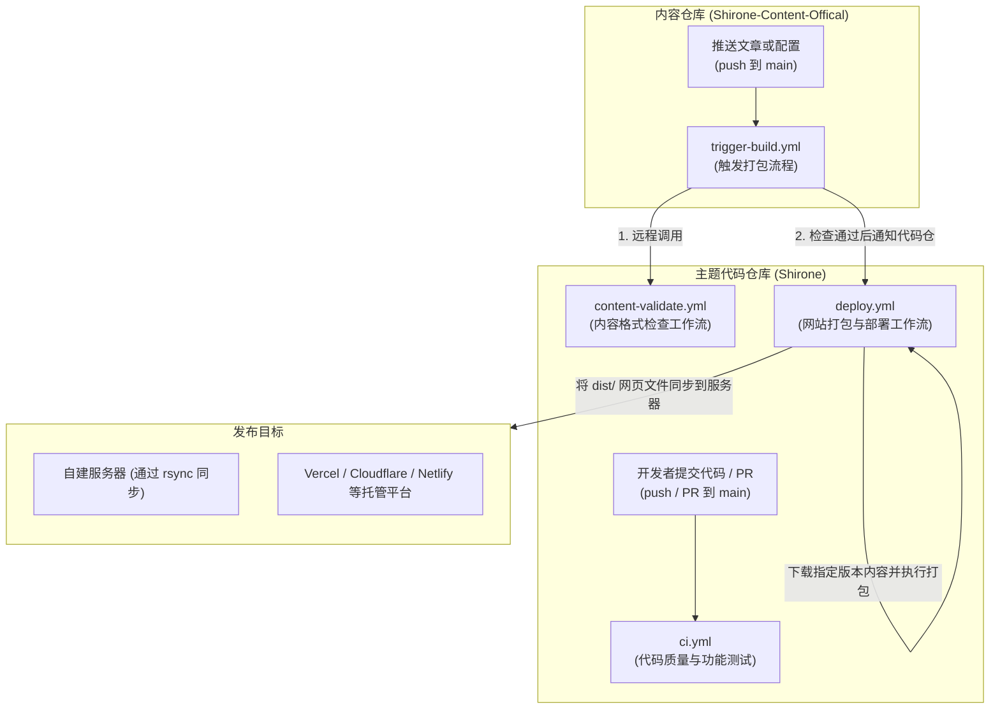
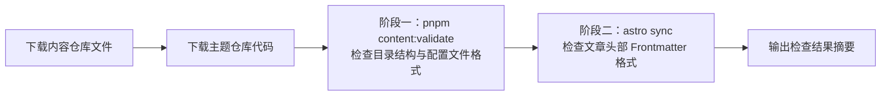

Shirone 提供了若干 GitHub Actions 自动化工作流，分别用于检查主题代码质量、校验文章内容格式以及执行网站自动打包与发布。



---

## 工作流清单

| 仓库 | 文件路径 | 触发条件 | 主要用途 |
| --- | --- | --- | --- |
| **主题代码仓** | `.github/workflows/ci.yml` | 提交代码到 `main` 分支、发起 PR、手动触发 | **代码检查与自动化测试**：检查代码格式、运行 TypeScript 类型检查以及测试浏览器页面渲染。 |
| **主题代码仓** | `.github/workflows/content-validate.yml` | 被外部仓库调用（`workflow_call`） | **内容格式检查**：供内容仓库调用，检查文件目录结构、YAML 配置文件以及文章头部信息是否规范。 |
| **主题代码仓** | `.github/workflows/deploy.yml.example` | 代码更新、收到内容仓库通知、定时计划、手动触发 | **网站打包与发布**：拉取内容仓库的文件并执行打包，将生成的 `dist/` 网页文件同步到服务器或托管平台。 |
| **内容仓库** | `.github/workflows/trigger-build.yml.example` | 修改文章或配置后推送、手动触发 | **内容更新触发器**：先调用主题仓的工作流检查内容格式，通过后再向主题仓发送打包通知。 |

---

## 1. 主题仓代码检查工作流 (`ci.yml`)

`ci.yml` 位于主题代码仓库中，每次向 `main` 分支提交代码或发起 Pull Request 时自动运行。

### 各步骤说明

1. **变动文件检测 (`changes` 任务)**
   - 运行脚本对比本次提交与之前的修改内容。如果只修改了评论相关代码，则只运行评论测试；如果修改了主题样式或字体，则运行样式测试；没有改动的部分会自动跳过以减少运行时间。
2. **代码规范检查 (`quality` 任务)**
   - 运行 Biome 工具检查代码格式与书写规范，并将提示信息标注在 GitHub PR 页面中。
3. **框架诊断与单元测试 (`checks` 任务)**
   - 检查 Astro 模板文件与 TypeScript 类型；
   - 检查 Svelte 界面组件的语法规范；
   - 运行针对基础功能的单元测试。
4. **打包完整性检查 (`build` 任务)**
   - 在固定的 Node.js 26 环境下运行 `pnpm build` 命令，确认代码改动后网站仍能正常打包输出。
5. **浏览器渲染与评论功能测试 (`comment-tests` 任务)**
   - 使用 Playwright 启动无头浏览器，分别在未开启评论、开启 Waline、开启 Twikoo 等不同配置下，测试网页功能是否正常。
6. **视觉样式检查 (`styles` 任务)**
   - 测试深浅色主题切换、字体加载以及页面横幅的展示情况。

---

## 2. 内容格式检查工作流 (`content-validate.yml`)

如果文章头部的配置字段拼写错误，或者配置文件中的 YAML 缩进格式不正确，打包时就会发生错误。

`content-validate.yml` 采用了 GitHub Actions 的可复用工作流机制（`workflow_call`），内容仓库可以直接调用主题仓库中的这套检查规则。

### 两个检查阶段



1. **阶段一：目录结构与配置文件格式检查 (`pnpm content:validate`)**
   - 检查内容仓库是否包含合规的 `content/` 与 `config/` 目录；
   - 检查 `config/*.yaml` 配置文件中的配置项名称与取值格式（如有拼写错误或格式不符合要求会提示具体位置）。
2. **阶段二：文章头部元数据检查 (`astro sync`)**
   - 将内容文件同步到主题目录后，调用 Astro 内容集合规则；
   - 检查每篇 Markdown 文章头部的分类、标签、日期、封面图等字段是否符合规范。
3. **生成检查摘要**
   - 检查完成后，会在 GitHub Actions 页面直接生成一份简要报告，展示检查是否通过。

---

## 3. 网站打包与发布流水线 (`deploy.yml.example`)

`deploy.yml.example` 负责将代码和文章合并打包，并上传到你的服务器。去掉文件名结尾的 `.example` 后缀后生效。

### 核心机制

- **支持多种触发方式**：
  - 开发者推送主题代码时触发（自动忽略文档类的改动）；
  - 内容仓库推送文章后，通过事件通知自动触发；
  - 可以在 GitHub 页面手动点击触发，并能指定历史版本的 Commit 编号以便快速回退；
  - 包含每天一次的定时触发，确保文章始终与内容仓库保持一致。
- **防止重复排队与并发竞争**：
  ```yaml
  concurrency:
    group: deploy
    cancel-in-progress: true
  ```
  如果短时间内连续推送了多次文章，新的打包任务会自动取消正在排队或执行中的旧任务，始终以最后一次推送的内容为准。
- **构建缓存机制**：
  - 图片缩略图等耗时处理的资源会被缓存起来，下次打包时直接复用未修改的图片；
  - 文章等文字内容不会混用历史缓存，确保删除的文章不会残留在新网站中。
- **预置发布方式**：
  文件末尾提供了常见的发布模板，根据需求取消对应的代码注释即可：
  - **自建服务器**：通过 SSH 连接和 `rsync` 命令将生成好的 `dist/` 网页文件增量上传到服务器；
  - **Vercel / GitHub Pages**：直接上传打包好的文件到云端平台。

---

## 4. 内容仓库触发工作流 (`trigger-build.yml.example`)

此工作流存放在独立的内容仓库中，用于在推送文章后自动通知代码仓库重新打包。

### 运行流程

1. **监听指定文件夹**：
   只在修改了 `content/`（文章）、`config/`（配置）、`data/`（数据）、`public/` 等核心目录中的文件时才触发，修改说明文档不会触发打包。
2. **前置格式检查 (`validate` 任务)**：
   在正式打包之前，先调用主题代码仓库的 `content-validate.yml` 进行格式检查。如果发现文章或配置文件存在格式错误，工作流会在内容仓库直接提示报错，避免生成错误的网站。
3. **向主题仓发送打包通知 (`dispatch` 任务)**：
   检查通过后，向主题代码仓库发送包含本次提交 Commit 编号的触发事件，通知主题代码仓库拉取最新的文章并开始打包。

---

## 下一步

- [部署到服务器](/guide/deploy/server/)：查看如何使用 GitHub Actions 将网站同步到个人服务器
- [跨仓自动构建](/guide/content-separation/ci-dispatch/)：查看双仓模式下令牌与权限的具体设置步骤
- [主题开发与贡献](/guide/development/theme-contributing/)：了解如何修改主题代码和新增组件
